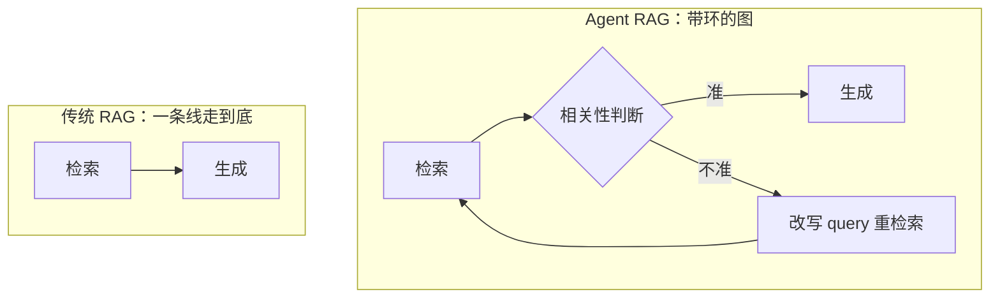
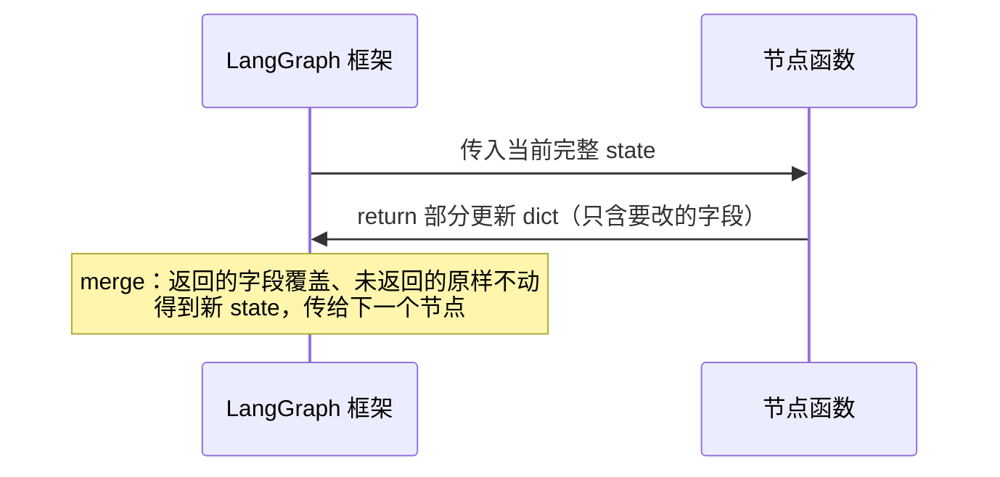
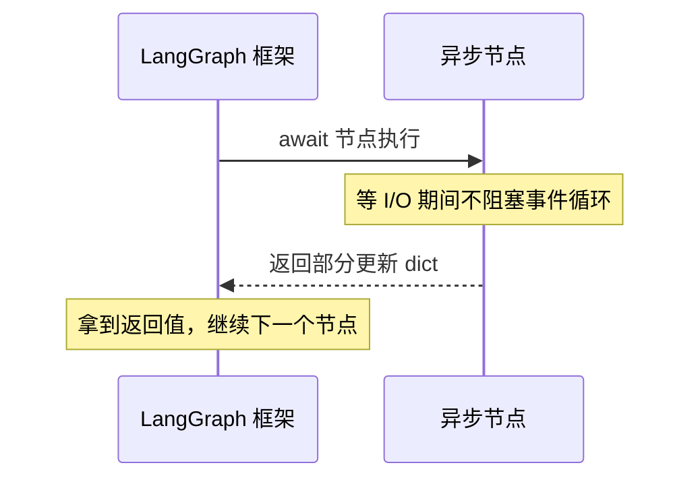
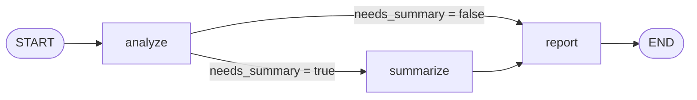
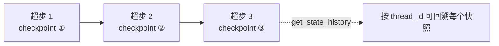

# 第 1 讲：LangGraph 入门——Agent 不是一条链，而是一张有状态图

> 本系列用可运行的最小 demo 讲 LangGraph 实战。这是第 1 讲（入门）：先讲清 LangGraph 的核心四件套——**State / Node / Edge / Checkpointer**，不引入 LLM 和工具。配套 demo 见同目录 `text_summary.py`。
>
> ⚠️ 本篇状态：**§1–§8 初稿完成**，待通读校对、demo 验证后发布。

**TL;DR**：LangGraph 把 Agent 建模成一张「有状态图」——State 是共享记忆，Node 是执行步骤，Edge 决定流向（固定边 + 条件路由），Checkpointer 让状态持久化、可回溯。四件套组合起来，才够支撑真实 Agent 的分支、循环、记忆与暂停恢复。

---

## 大纲（§1–§8）

### §1 为什么是「图」而不是「链」

基于「链」（Chain / LCEL）的 LangChain 已经足够成功，为什么官方还要推出以「图」为核心的 LangGraph？答案藏在官方博客给它的定位里：LangGraph 是「在 LCEL 之上、以**循环**的方式协调多个步骤（actor）」的库——它补的正是链缺的那一块。说到底，链在拓扑上是**有向无环图（DAG）**，只能「一条路走到底」，表达不了环；而当前主流的 Agent 恰恰是「思考—行为—观察」的循环范式，天然要环。

具体讲，真实 Agent 需要下面四样链无法有效建模的运行机制：

1. **循环执行**：ReAct 循环（「思考—行为—观察」）及它的各种变种——LLM 调工具 → 观察结果 → 再决定下一步，直到给出最终答案。这是环，不是线。
2. **分支路由**：要能基于「当前执行到哪、状态是什么」做条件判断，把流程拐向不同节点。这里容易有个误会——LangChain 不是「完全没有状态」，而是它的状态只是「沿链单向传递的一个值」，得手动穿针引线；分支在 LCEL 里（`RunnableBranch`）能做但别扭。LangGraph 把「一份被所有节点共享、可读可写、可据此路由」的状态做成了一等公民。
3. **状态持久化 + 检查点恢复**：特别是长程任务，中途要对状态做快照，失败后从最近快照续跑，而不是从头重来。LangChain 也能手搓检查点代码，但 LangGraph 把它做成了内置的一等公民（checkpointer），开箱即用。
4. **人机协同（HITL）**：高危不可逆操作要暂停、呈报人工审批、再恢复继续。这需要「暂停 + 持久化 + 恢复」一整套机制，链没有内置的 interrupt/resume 能力，是真的做不到（本文点到为止，02 篇专门展开）。

举个具体例子——官方博客里的「传统 RAG vs Agent RAG」对比：



传统 RAG 是「检索 → 生成」一条线：检索结果不准时，它没有回头路，只能硬着头皮用烂结果生成错误答案。Agent RAG 把流程变成一张带环的图：检索后先判断相关性，不准就改写 query 重新检索，直到拿到靠谱结果再生成——「回头重检索」这个环，正是链表达不了的。

从理论上讲，CoALA（Cognitive Architectures for Language Agents）把语言 Agent 拆成「记忆 + 动作空间 + 决策循环」三块，且三块两两交互成环——记忆为决策提供信息，决策结果沉淀回记忆，决策与动作空间之间就是 ReAct 循环。所以 Agent 的骨架天然是一张带循环的图，不是链。

说到底，「链其实是图的特例」——一条直线不过是图退化的形态。用图不等于把简单变复杂：简单流程时它退化成链，复杂流程时它展开成图。下面几节，我们就具体看用图对当前主流 Agent 建模需要哪几个组件。

### §2 State：图上流动的共享记忆

**State 是图上的共享记忆**——一份在节点之间流动、所有节点都能读写的数据。节点执行时把它当作输入，处理完产出「部分更新」交还给框架，框架据此得到新的 State。它用一个 `TypedDict` 定义：

```python
class State(TypedDict):
    text: str
    word_count: int
    needs_summary: bool
    summary: str
    report: str
```

注意：`TypedDict` 定义的是 State 的**结构（schema）**——它有哪些字段、各自什么类型，**不是值**；值要等运行时才被写入。

LangGraph 对 State 的更新遵循**单线程顺序执行**：节点一个接一个跑，每跑完一个就合并它的返回值。具体分三步：

1. 节点函数入参 = **当前完整 state**；
2. 节点返回一个 dict，**只含它要修改的字段**——这就是「部分更新」；
3. 框架把这个 dict **合并（merge）** 进 state——返回的字段覆盖、未返回的字段原样不动，得到新 state，再传给下一个节点。



所以 demo 里 `analyze()` 只返回了 `word_count` 和 `needs_summary` 两个字段，框架把它们写进 state，而 `text`、`summary` 等其余字段**原样保留**——于是后面的 `report()` 才能读到 `text` 和 `summary`。

最后还有一个容易踩坑的细节：state 字段的更新默认是**覆盖**。这对"单值"字段没问题，但对**列表**字段（比如对话里的 `messages`）就是灾难——每个节点往里加消息，默认覆盖会让后一个节点把前一个节点加的消息整个冲掉。所以对"要累积"的字段，得显式声明一个 **reducer**（告诉框架"旧值和新值该怎么合并"），写法是在字段类型外套一层 `Annotated`：

- `Annotated[list, add_messages]`：给 `messages` 列表专用，新消息**追加**到末尾；
- `Annotated[list, operator.add]`：通用的列表追加（新列表拼到旧列表后面）。

本 demo 的字段都是单值，用默认覆盖就够了；§8 会看到真实 Agent 的 `messages` 为什么必须用 reducer。

### §3 Node：最小执行单元

Node 是 LangGraph 的**最小执行单元**，本质就是一个普通 Python 函数——不需要继承任何类、也不需要加任何装饰器。它的入参是当前 state，返回值有两种合法情况：**部分更新的 dict**（更新某些字段），或 **`None`**（不改任何字段）。后者很常见——比如一个节点只做副作用（写日志、发邮件）、不碰 state，就 `return None`。

LangGraph **同步、异步节点都支持，还能混用**。关键要理解：异步节点并不是「后台偷偷跑」。

- **声明**：异步节点就是 `async def node(state) -> dict`，返回值约定和同步完全一样（部分更新 dict 或 `None`）。
- **框架会 `await` 它**：异步节点跑起来后，框架会等它执行完、拿到返回值，再继续走下一个节点——async 只是让「等 I/O 的那段时间」不阻塞事件循环，不是乱序执行。
- **调用侧**：图里有异步节点 → `await graph.ainvoke(...)`；全是同步节点 → `graph.invoke(...)`。
- **什么时候用 async**：节点里有 I/O / 网络请求（LLM 调用、查库）时用 async，等待时不阻塞；纯 CPU 计算用 sync 就行。



> async 真正的收益在于：I/O 等待不阻塞事件循环——在异步服务里能同时服务其他请求；配合图的**并行分支**时收益更大（并行分支属进阶话题，本篇不展开）。

### §4 Edge：固定边 vs 条件边

图里节点之间的连线叫**边（Edge）**，它决定「跑完这个节点，下一个是谁」。LangGraph 有两种边：

- **固定边** `add_edge("summarize", "report")`：无条件，`summarize` 跑完**一定**跑 `report`。
- **条件边** `add_conditional_edges("analyze", route, {...})`：跑完 `analyze` 后，先调用 `route` 函数，**读当前 state 里的字段**决定下一个节点。

条件边的核心是 `route` 函数：

```python
def route(state: State) -> str:
    """读 state 决定拐向哪个节点，返回一个「键」。"""
    return "summarize" if state["needs_summary"] else "report"
```

它返回一个「键」（可以是节点名，也可以是任意的语义键）。第三个参数就是**把键翻译成真正节点名**的映射（path map）：

```python
g.add_conditional_edges("analyze", route, {"summarize": "summarize", "report": "report"})
```

所以 route 的返回值**不必等于节点名**——你可以让它返回 `"needs_summary"` 这种语义键，再在 path map 里映射到 `"summarize"` 节点。这个解耦的好处是：改路由时不用动 `route` 函数，只改映射表。

最后是 `START` / `END`：官方叫**哨兵（sentinel）**。它们不是真正的节点函数（背后没有 Python 函数），只是标记「图从哪进、到哪停」的占位符。

配上 demo 的整张图：



### §5 组装 → 编译 → 运行

把前四节串起来，一张图从「图纸」到「跑起来」要经历三个阶段。

**① 组装 = 声明**。`StateGraph`、`add_node`、`add_edge` 都是在**声明**这张图长什么样——注册节点、接线，但**不执行任何节点逻辑**：

```python
def build_graph():
    g = StateGraph(State)          # 用 State 定义图共享的状态结构
    g.add_node("analyze", analyze) # 注册节点
    g.add_node("summarize", summarize)
    g.add_node("report", report)

    g.add_edge(START, "analyze")   # 接线
    g.add_conditional_edges("analyze", route, {"summarize": "summarize", "report": "report"})
    g.add_edge("summarize", "report")
    g.add_edge("report", END)
```

跑到这里，`g` 还只是一张**图纸**——它描述了有哪些节点、怎么连，但一个函数都没被调用过。

**② 编译 = 把图纸变成可运行对象**：

```python
return g.compile(checkpointer=MemorySaver())
```

`compile` 做几件事：校验图是否完整（有没有孤立节点、入口/出口接没接好）；为每个 state 字段建立**状态通道**（决定怎么初始化、怎么合并）；把节点和边转成内部可执行的结构；注入 checkpointer（让每步 state 能落盘）；最后返回一个 compiled graph——**只有它才有 `invoke` / `stream` 方法**，之前那个 `StateGraph` 是没有的。

**③ 运行 = invoke**：

```python
graph = build_graph()
result = graph.invoke({"text": long_text}, {"configurable": {"thread_id": "doc-long"}})
```

`invoke` 接两个参数：**初始 state**（图的起点状态，框架从 `START` 出发把它传给第一个节点）和 **config**（运行时配置，最关键的是 `thread_id`，标识这次运行属于哪个会话——它的深挖留到 §6）。

> LangGraph 还支持**并行分支**（一个节点引出多条边、同时跑），那才是 async 收益最大的场景；但本篇 demo 是顺序流程，不展开。

### §6 Checkpointer：让图「有状态」

**checkpointer 存什么**：图每跑完一个**超步**（super-step，官方术语，你理解成「图的一次执行节拍」——这一拍里该跑的节点都调度完），checkpointer 就在边界写一次 **checkpoint**：那个时刻的完整 state 快照 + 元数据（下一步要跑哪个节点）。

**thread_id 是存取的主键**：checkpointer 靠 `thread_id` 索引这些 checkpoint。同一个 `thread_id` 跑两次，状态是**连续**的（后一次接着前一次的上下文）；不同 `thread_id` 各跑一次，各自独立。反过来，如果 `compile()` 时不传 checkpointer，状态根本不会落盘，也就谈不上重载。

**回溯 + 短期/长期记忆**：有了落盘，就能回溯——`get_state()` 取**最新**快照，`get_state_history()` 取**全部历史**快照，加载某个历史快照重跑，就是官方说的 **time travel**。注意区分：checkpointer 存的是**单会话内的短期记忆**，store 存的是**跨会话的长期记忆**——本篇只用 checkpointer。demo 里 `main()` 末尾那句 `graph.get_state(...)` 就是取 `doc-long` 会话的最新快照。

配上图（每个超步一个 checkpoint）：



### §7 几个易混点（速查）

这一路容易踩的坑，前面几节其实都点过了，这里集中列一遍，方便你回头查：

- **节点返回「部分更新」，不是整个 state**——没返回的字段原样保留（见 §2）。
- **state 字段默认「覆盖」**，列表要累积得用 reducer：`Annotated[list, add_messages]` / `Annotated[list, operator.add]`（见 §2）。
- **条件边的 path map 是「返回值 → 节点名」映射**（见 §4）。

再补两个前面没展开的：

1. **path map 必须覆盖 `route` 的所有返回值**。`route` 返回一个 path map 里没有的键，运行时会直接抛错（找不到对应节点）。要稳妥，就给 `route` 的返回类型加 `Literal` 约束，让类型检查提前把这种错揪出来。

2. **忘配 checkpointer / 忘传 `thread_id`**。`compile()` 不传 checkpointer，或 `invoke()` 不传含 `thread_id` 的 `config`，后面 `get_state` 就会失效或报错（见 §6）。

### §8 生产化延伸 + 总结

**生产化延伸**：这个 demo 是「能跑起来」的最小骨架，离生产还差几段，主要是三处：

- **checkpointer 要换**：`MemorySaver` 存内存、进程一死就没了，只适合测试；生产低量单进程用 `SqliteSaver`，正经服务用 `PostgresSaver`（落库、重启不丢）。
- **state 要升级**：真实 Agent 的核心字段是 `messages`（对话历史），它必须用 `add_messages` reducer 累积——这正是 §2 说的「列表字段默认覆盖会冲掉历史」的解法。
- **还缺很多**：本篇为了讲清四件套，刻意没引入 LLM 调用、工具、HITL，那些正是后续几篇要补的（02 HITL、04 工具循环…）。

**总结**：一句话——LangGraph 用「State + Node + Edge + Checkpointer」四件套，把 Agent 建模成一张**有状态图**：State 是共享记忆，Node 是执行步骤，Edge 决定流向（固定 + 条件），Checkpointer 让状态可持久化、可回溯。

面试常被追问的两点，答案已经埋在前文：

1. **「为什么用图而不是链？」**——链是 DAG，表达不了环；Agent 的「思考—行为—观察」天然是环（§1）。
2. **「state 怎么合并？」**——节点返回「部分更新」，框架 merge：返回的字段覆盖、未返回的原样不动；要累积的字段显式用 reducer（§2）。

读完这篇，你已经有了一张能跑的最小图。下一篇（第 2 讲）会在这个骨架上加第一道「真东西」——高危操作的人工审批。

---

## 参考文献

1. **LangGraph 官方文档《Quickstart》** — <https://docs.langchain.com/oss/python/langgraph/quickstart>
2. **LangGraph 官方文档《Persistence》** — <https://docs.langchain.com/oss/python/langgraph/persistence>
3. **LangGraph 官方文档《Add Memory》** — <https://docs.langchain.com/oss/python/langgraph/add-memory>
4. **LangChain 官方博客《LangGraph》（发布博客）** — <https://blog.langchain.dev/langgraph/>
5. **DeepWiki《LangGraph Core Concepts》（langchain-ai/langchain-academy）** — <https://deepwiki.com/langchain-ai/langchain-academy/3-langgraph-core-concepts>
6. **futureagi《What is LangGraph? Stateful Agent Graphs Explained in 2026》** — <https://futureagi.com/blog/what-is-langgraph-2026/>
7. **腾讯云开发者社区《LangGraph 入门：StateGraph、节点与边、循环控制与持久化检查点》** — <https://cloud.tencent.cn/developer/article/2730810>
8. **学术：CoALA《Cognitive Architectures for Language Agents》** — <https://arxiv.org/abs/2309.02427>

---

完整代码：[`text_summary.py`](https://github.com/wanghesong2019/langgraph-in-action/blob/main/01-state-graph/text_summary.py)
