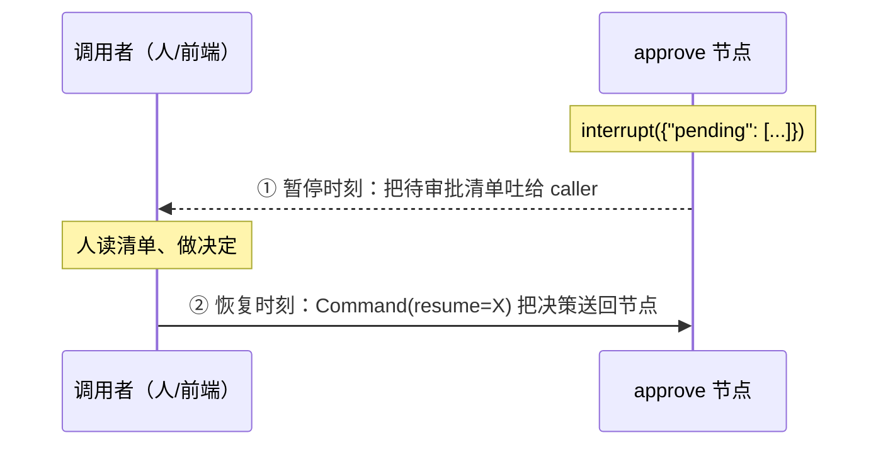
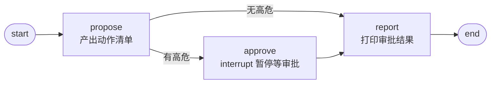

# 第 2 讲：HITL——让 Agent 学会"先问再做"，给高危操作加一道人工审批闸门

> 本系列用可运行的最小 demo 讲 LangGraph 实战。这是第 2 讲：上一篇（第 1 讲）搭好了 State / Node / Edge / Checkpointer 四件套骨架，这篇往上加第一道「真东西」——让 Agent 在"高危动作"前停下来等人工审批。配套 demo 见同目录 `refund_approval.py`。

**TL;DR**：HITL 的本质 = 在 Agent 执行流程里强留一个人类介入的口子。落地三步：① 给动作打风险标签（`risk_level`）② 高危动作用 `interrupt()` 暂停等人工审批 ③ 配 checkpointer + thread_id 才能 resume。

## §1 为什么 Agent 不能全自动？

现在的客服 Agent，能力上已经能做和人类客服一样的事了。但让它自主跑全流程跟客户交涉，技术上可行，业务上却不是明智之举——客服难免涉及**取消订单、退款、退货**这类高危动作。就算 Agent 掌握了工单的完整上下文，"要不要给客户退款"这个最终决策，最好还是由人来拍板：因为退款一旦执行，主动权就转移到了客户一方，属于**不可逆**的高危动作。

那么，怎么在技术上**严格保证**"所有高危行为都会上报给人审批"？不能靠"模型自觉"——也就是在 system prompt 里写一句"高危操作要谨慎、先征得同意"这种**软约束**。软约束会随长上下文被压缩、稀释，甚至直接丢掉，等于没设。可靠的做法，是在流程里设一道**硬闸门**。

> *"An ungated risky step will run. 'It's obviously dangerous, surely it will check first' is not how it works."* —— [Duvo](https://docs.duvo.ai/best-practices/when-to-ask-a-human)

那这道硬闸门该怎么设计？

## §2 风险分级：先给动作打标签

第一步不是上闸门，而是**给 Agent 的每个动作做风险分级**——每个动作都带一个风险标签 `risk_level`，而"是否需要审批"由它派生出来，而不是单独再存一个布尔字段：

```python
@dataclass
class Action:
    """一个待执行动作 + 风险等级。"""

    name: str
    risk_level: str = "low"  # low / high

    @property
    def requires_approval(self) -> bool:
        """派生属性 = 单一真相源：risk_level 是唯一事实，由它算出，避免两字段打架。"""
        return self.risk_level == "high"
```

> （注：demo 的 state 存 dict 是为了能被 checkpointer 干净序列化——自定义对象进 state 会触发 msgpack 警告。所以 demo 里 `route`/`approve` 直接判 `risk_level`；真实项目用 Pydantic 模型承载 state 时，就能直接写 `a.requires_approval`。）

为什么用 `@property` 派生，而不是单独存一个布尔字段？——**单一真相源（single source of truth）**：凡是能从别处推导出来的状态，就不要存两份。`risk_level` 是唯一事实，`requires_approval` 是"读的时候算出来"的，所以永远不会出现 `risk_level="high"` 但 `requires_approval=False` 这种两字段打架的 bug。

至于"什么算高危"，有两条判据：
1. **可逆性 / 可控性**——删除、发布、付款这类动作，一旦执行就不完全可控了（付款后能不能退款就看对方了）。
2. **影响范围**——动作发生在组织内部（危害可控），还是直面客户（发邮件、寄合同、付款，尽量按高危走审批）。

可选第三条（量化版）：**金额 / 敏感度阈值**——退款 ¥199 是高危，¥0.01 也许就不必惊动人。

## §3 硬闸门：interrupt/resume 机制

风险分级只是"打标签"，真正的闸门是 LangGraph 的 `interrupt()`。它一个调用衔接了**两个方向、两个时刻**：

- **暂停时刻（参数）**：`interrupt({"pending": [...]})` 的参数，方向是「节点 → 调用者」——把高危动作清单"吐"给等在外面的 caller（人/前端）。
- **恢复时刻（返回值）**：当 caller 用 `Command(resume=...)` 恢复时，`resume` 里的内容原样变成 `interrupt()` 的**返回值**，方向是「调用者 → 节点」——人工决策送回节点。

官方博客给它的比喻是"生产级、异步版的 `input()`"：`input()` 阻塞线程、进程一死就丢；`interrupt()` 不阻塞、把状态持久化，重启后还能从暂停点继续。

时间线四步：`invoke` 跑到 interrupt → 暂停并把 state 持久化、返回 `__interrupt__` → 人读清单做决定 → 再次 `invoke(Command(resume=...))` 恢复继续。



demo 里的 `approve()` 节点就是这道闸门：

```python
def approve(state: State) -> dict:
    """审批节点：把高危动作吐给外部，interrupt 暂停等人。"""
    pending = [a for a in state["actions"] if a["risk_level"] == "high"]
    # 参数 = 节点→调用者（吐待审批清单）；返回值 = 调用者→节点（= Command(resume=X) 的 X）
    decision = interrupt({"pending": pending})
    approvals = []
    for i, a in enumerate(pending):
        d = decision.get(str(i)) if isinstance(decision, dict) else None  # 防御：非 dict 降级 pending
        approvals.append({"name": a["name"], "decision": d or "pending"})
    return {"approvals": approvals}
```

## §4 两个前提：checkpointer + thread_id

要能"暂停又恢复"，缺这两个前提之一都 resume 不了。

**前提 1：checkpointer（状态持久化层）。** 官方博客叫它"human/agent 协作的 scratchpad"。图每跑一步都会读写 checkpoint；`interrupt()` 暂停时把 state 存进去，resume 时读回来。demo 用 `MemorySaver`（内存），生产换数据库（`SqliteSaver`/`PostgresSaver`），重启不丢：

```python
g.compile(checkpointer=MemorySaver())
```

**前提 2：thread_id（会话标识）。** checkpointer 靠它区分"这个 checkpoint 属于哪个会话"。两次 `invoke` 必须用**同一个** `thread_id`，框架才知道 resume 的是哪次暂停：

```python
config = {"configurable": {"thread_id": "demo-1"}}
graph.invoke({"actions": [], "approvals": []}, config)   # 第一次：跑到 interrupt 暂停
graph.invoke(Command(resume={"0": "approved"}), config)  # 第二次：同 thread_id 恢复
```

> 一个容易混的点：resume 后，节点会**从头重跑**，不是从 `interrupt()` 那一行接着执行。这是 LangGraph 的执行行为，不是 checkpointer 干的——checkpointer 只管"状态存续"，重跑是运行时决定"从哪执行"。它带来的副作用幂等问题，§6 再讲。

## §5 图上接线：条件路由"高危才拦"

把 `propose` / `approve` / `report` 三个节点串成一张图：



```python
def build_graph():
    g = StateGraph(State)
    g.add_node("propose", propose)
    g.add_node("approve", approve)
    g.add_node("report", report)
    g.add_edge(START, "propose")
    g.add_conditional_edges("propose", route, {"approve": "approve", "report": "report"})
    g.add_edge("approve", "report")
    g.add_edge("report", END)
    return g.compile(checkpointer=MemorySaver())  # checkpointer 必须，否则 resume 不了
```

关键在 `propose` 之后那条**条件边**——它由 `route()` 决定拐向哪：

```python
def route(state: State) -> str:
    """条件路由：只要有一条高危，就拐进 approve；否则直接收尾（低危不打断，避免审批疲劳）。"""
    return "approve" if any(a["risk_level"] == "high" for a in state["actions"]) else "report"
```

逻辑就一句：**有高危 → approve，否则 → report**——这就是"高危才拦"。这么设计有个看似反直觉的好处：**低危放行、高危才拦，反而是更安全的选择**。因为如果每条动作都送审批，审批者会被海量"记日志"这种无害请求淹没，逐渐变成橡皮图章——无论什么请求都无脑点"同意"，闸门就形同虚设了。只在高危处打断，才能在 autonomy（低危自动）和 oversight（高危把关）之间取平衡，保住闸门的有效性。

## §6 三个容易被忽略的坑

HITL 的机制本身不复杂，但有几个坑很容易踩：

**1. `interrupt()` 不能包在 `try/except` 里。** LangGraph 里 `interrupt` 是靠**抛一个特定异常**来暂停图执行的；一旦用 `try/except` 包住，异常被捕获、暂停就不会发生，高危动作会在没人批准的情况下直接执行。

**2. resume 的格式框架不规定，是代码"隐含约定"的。** `Command(resume=X)` 里的 `X` 可以是任意对象，格式完全由你自己定。比如 demo 里：

```python
graph.invoke(Command(resume={"0": "approved"}), config)  # 约定：dict，key=下标 "0"，value=approved/rejected
```

这个格式是 `approve()` 里的 `decision.get(str(i))` 那行**写死**的。正因框架不管，代码里才要防御——`isinstance(decision, dict)` 不成立就降级 `pending`，否则 caller 传个非 dict，`.get()` 直接崩。

**3. resume 后节点"从头重跑"。** 恢复不是从 `interrupt()` 那行接着执行，而是整个节点重跑一遍。所以 `interrupt()` 之前如果有一行副作用（写库、发消息），会被重复执行。规避办法：把副作用移到 `interrupt()` 之后，或者把它做成**幂等**。

## §7 生产化延伸

demo 只做了 approve / reject **两态**，真实生产往往还需要另外两态：

- **`edit`（改参数）**：意图对了、参数错了，人改完就放行——比如"发邮件"的收件人写错了，人改成正确的再执行。
- **`respond`（把人类当工具）**：模型调一个"问用户"的工具，人类的话作为这个工具的返回值流回模型。本质是**把人类变成一个工具**，用于"模型需要向人问一句话"的场景。

而 `edit` 和 `reject` 的区别是：`edit` 是"改对就放行"，`reject` 是"整个动作都不该做，拦下"。

另一个关键原则是**外部审批通道**：审批权必须落在 Agent 的信任域之外。如果 Agent 自己能调审批接口，就等于关掉了外部反馈通道，而且一旦被 prompt injection 攻破，攻击者可以让 Agent 对大量正常订单"自我批准"发起退款——因为没人能拦它。

除了四态和外部通道，生产还有几个绕不开的点：

- **timeout 默认拒绝**：审批请求要带超时，超时未处理默认拒绝（deny-on-timeout），而不是默认放行或无限等待——否则一个没人管的审批就卡死流程，甚至超时放行等于闸门失效。
- **审计留痕**：谁、何时、批准/拒绝了什么，记一条 append-only 日志，出问题能回溯到"是谁批的"。
- **durable workflow**：审批可能等数小时甚至数月（人休假、走流程），不能让活进程一直占着等；用 durable 基础设施让"等待"脱离进程生命周期。
- **数据库 checkpointer**：demo 用 `MemorySaver`（内存），进程一重启暂停的状态就没了；生产换 `SqliteSaver` / `PostgresSaver`，状态落库、重启换机器都能 resume。

## §8 总结

一句话：**HITL = 在 Agent 的执行流程里强留一个人类介入的口子**——通过这个口子，人把自己的经验、踩过的坑反馈给 Agent，让它规避风险、更好地对齐人类。

一个面试常被追问的点："为什么用动态 `interrupt()` 而不是静态 breakpoint（`interrupt_before`/`interrupt_after`）做 HITL？" 三条：

1. **位置**：静态 breakpoint 只能在节点边界固定暂停（编译时写死）；动态 `interrupt()` 能在节点内部任意位置、按条件暂停（"只有高危才 interrupt，低危直接过"——静态做不到条件式）。
2. **载荷**：动态 `interrupt(payload)` 能带业务载荷（把待审批清单吐给 caller）；静态只暂停、不带载荷。
3. **官方定位**：官方文档明说静态 breakpoint"不推荐用于 HITL，是调试/测试用的"，动态 interrupt 才是 HITL 的正解。

---

## 参考文献

1. **LangGraph 官方文档《Interrupts》** — <https://docs.langchain.com/oss/javascript/langgraph/interrupts>
2. **LangChain 官方博客《Making it easier to build human-in-the-loop agents with interrupt》** — <https://www.langchain.com/blog/making-it-easier-to-build-human-in-the-loop-agents-with-interrupt>
3. **LangChain 官方文档《Human-in-the-loop（concepts）》** — <https://docs.langchain.com/oss/javascript/concepts/human-in-the-loop>
4. **Duvo《When the Agent Should Ask, Not Act》** — <https://docs.duvo.ai/best-practices/when-to-ask-a-human>
5. **Cloudflare Agents《Human-in-the-loop patterns》** — <https://developers.cloudflare.com/agents/concepts/agentic-patterns/human-in-the-loop/>
6. **awesome-agentic-patterns《human-in-loop-approval-framework》** — <https://github.com/nibzard/awesome-agentic-patterns/blob/main/patterns/human-in-loop-approval-framework.md>
7. **IEEE Access 2024《Applications, Challenges, and Future Directions of Human-in-the-Loop Learning》** — <https://ieeexplore.ieee.org/abstract/document/10530996>

---

完整代码：[`refund_approval.py`](https://github.com/wanghesong2019/langgraph-in-action/blob/main/02-hitl/refund_approval.py)
