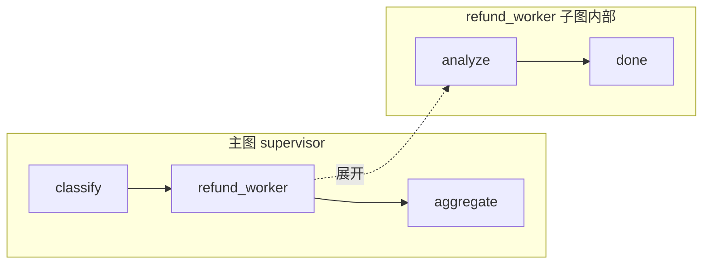
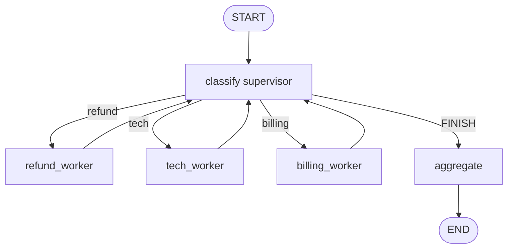

# 第 3 讲：多 Agent——Supervisor 分诊 + 专职 Worker

> 本系列用可运行的最小 demo 讲 LangGraph 实战。这是第 3 讲：把单个 Agent 拆成一个「supervisor 调度中枢」+ 多个「专职 worker」，让每个专职只干自己擅长的事。配套 demo 见同目录 `ticket_triage.py`。

**TL;DR**：多 Agent 的核心是「分诊 + 专职」——一个 supervisor 读请求、判断需要哪些专职（可能多个）、**逐轮派发（loop-back）**；每个 worker 是**独立 compile 的子图**，处理完回到 supervisor 继续调度；队列空了才聚合。好处是每个专职的 prompt、工具、上下文彼此隔离。

---

## 大纲（§1–§8）

### §1 为什么需要多 Agent

单个大 agent 的病灶是「注意力稀释」——上下文越长，模型对关键信息的注意力越分散；多 agent 的对策是「分而治之」——每个专职只看自己的一亩三分地。下面从三个层面展开。

**单 agent 的痛点**。一个「全能大 prompt」的 agent 会同时撞上三个卡点：一是**上下文膨胀**——随着执行流程越走越长，模型开始遗忘、幻觉、指令漂移，甚至撑爆上下文窗口；强行压缩上下文，又会稀释甚至丢掉关键指令。二是**职责冲突**——它要肩负各种职责、调用各种工具，在重复探索工具空间的过程中 token 消耗激增。三是**难调试**——上下文爆炸、职责冲突、工具调用混淆搅在一起，出问题时极难定位。

**拆分的收益**。拆成 supervisor + 专职 worker 后，supervisor 负责任务拆解与分配，每个 worker 专职一种职能、只调用跟它相关的工具，**上下文彼此隔离**——单 agent 的上下文膨胀和职责混淆随之消失；调试也变得简单：可以给每个专职单独构造测试用例、独立调优。

**拆分的代价**（诚实边界）。多 agent 不是免费的午餐：agent 之间靠 state 传数据，必须保证 state 一致，带来协调开销；职责拆分让执行链路变长，token 总量可能数倍增长；supervisor 的拆解分配还会引入**路由出错**的风险；上下文在 agent 之间传递，受长度和存储限制，也会有信息损耗。


### §2 Supervisor：分诊中枢

supervisor 是「调度中枢」——它自己不碰具体工单逻辑，只负责四件事：**拆解与路由**（决定调用哪个专职 worker）、**提供输入**（把工单上下文交给被派到的 worker）、**合并结果**（汇总各专职的产出）、**维护全局记忆**（记住整个会话的进展）。它和 worker 的分工边界就一条：**是否处理具体工单逻辑**——碰了就是 worker 的活，不是 supervisor 的。

这里要辨析一对容易混的概念：**supervisor vs router**。supervisor 是维护全局上下文、在多轮里动态决定调用哪个子 agent 的**完整 agent**；router 只做一次性的分类、把请求发给对应 agent，**不维护持续状态**。一句话：supervisor 是**架构级的任务分配**，router 是**节点级的路由**。我们 demo 的 `classify` + `pending` + loop-back 是 supervisor——因为 loop-back 这种「非一次性路由」正是 supervisor 的特征。

supervisor 的决策依据在 `route()` 里一目了然：

```python
def route(state: State) -> str:
    """条件路由：待办非空 → 派给队首专职；空了 → 去聚合。"""
    return state["pending"][0] if state["pending"] else "FINISH"
```

它读 `pending` 队列的队首决定「下一个派谁」；当 `pending` 空了，返回终止信号 `FINISH`，结束调度、进入聚合。

### §3 专职 Worker：子图是一等公民

为什么每个 worker 要 compile 成「子图」，而不是直接写一个普通节点函数？因为子图是一个**有自己的内部步骤的迷你图**——它能独立编译、独立复用、内部结构对外封闭；普通节点函数只有一步，装不下一个专职的完整流程（demo 里每个 worker 内部就是 `analyze → done` 两步）。这正是 LangGraph 多 Agent 的底座：**子图是一等公民**。

子图和主图的 state 关系有两种：**schema 相同**时，子图读写和主图一样的字段，直接 `add_node("worker", worker_subgraph)` 挂上去即可（demo 就是这种情况）；**schema 不同**时，需要写一个包装函数，把主图状态映射成子图的输入、再把子图输出映射回主图。

所以「一等公民」具体体现在：子图可以**独立编译**、可以**当节点挂进别的图**、可以**嵌套复用**——这让每个专职能各自独立开发、测试、版本化，再由 supervisor 组合起来。



### §4 组装：把子图挂进主图

前几节的零件都齐了——supervisor 的 `classify`、三个专职 worker 子图、`aggregate`。这一节把它们组装成一张完整的主图。`build_graph()` 干三件事：**挂节点**（`add_node` 把 classify、三个 worker 子图、aggregate 挂进主图）、**接条件路由**（`add_conditional_edges` 让 classify 按分诊键派单）、**接 loop-back**（三个 worker 处理完都回到 classify）。

```python
def build_graph():
    g = StateGraph(State)
    g.add_node("classify", classify)
    g.add_node("refund_worker", refund_worker)      # 三个专职是「子图」
    g.add_node("tech_worker", tech_worker)
    g.add_node("billing_worker", billing_worker)
    g.add_node("aggregate", aggregate)

    g.add_edge(START, "classify")
    g.add_conditional_edges(
        "classify",
        route,
        {"refund": "refund_worker", "tech": "tech_worker", "billing": "billing_worker", "FINISH": "aggregate"},
    )
    # loop-back：每个专职处理完，回到 classify 继续调度下一轮
    g.add_edge("refund_worker", "classify")
    g.add_edge("tech_worker", "classify")
    g.add_edge("billing_worker", "classify")
    g.add_edge("aggregate", END)
    return g.compile(checkpointer=MemorySaver())
```

注意最后三条 `add_edge("xxx_worker", "classify")`——这就是 **loop-back 的全部秘密**。没有它们，图就是一次性的 router：classify → worker → 结束；有了它们，worker 处理完会**回到 classify**，supervisor 再读一遍 `pending`，决定"继续派下一个专职"还是"去聚合"。

整张图长这样：



从 START 进来 → classify 分诊 → 按 `pending` 逐轮派给三个 worker（下面三条回边就是 loop-back，回到 classify 再派）→ `pending` 空了走 FINISH → aggregate → END。

### §5 条件路由：派给对的专职

supervisor 分诊完，怎么把工单"派"给对的 worker？靠**条件路由**：`route` 函数读 `pending` 队首，返回一个「分诊键」，path map 再把这个键翻译成真正的节点名。

```python
def route(state: State) -> str:
    """条件路由：待办非空 → 派给队首专职；空了 → 去聚合。"""
    return state["pending"][0] if state["pending"] else "FINISH"
```

`route` 返回的是**分诊键**（`refund` / `tech` / `billing`），不是节点名。真正的「键 → 节点」翻译发生在 `add_conditional_edges` 的第三个参数（path map）里：

```python
g.add_conditional_edges(
    "classify",
    route,
    {
        "refund": "refund_worker",   # 分诊键 → 节点名
        "tech": "tech_worker",
        "billing": "billing_worker",
        "FINISH": "aggregate",        # 队列空了 → 直接聚合
    },
)
```

这里有个**很容易踩的坑**：`route` 的返回值必须和 path map 的**键**一致，否则运行时会抛 `KeyError`（找不到对应节点）。写这个 demo 时我就踩过一次——一开始让 `route` 直接返回节点名 `"refund_worker"`，而 path map 的键却是 `"refund"`，两边对不上，`invoke` 直接报 `KeyError: 'refund_worker'`。改成「route 返回键、path map 翻译」后就正常了。这也是 path map 存在的意义：**把"决策结果"和"实际节点"解耦**——以后想改路由，只动 path map、不用动 `route`。

### §6 聚合 + loop-back：收回来继续调度

工单「派」给 worker 之后，worker 子图内部一边处理、一边维护待办队列：

```python
def _make_worker(name: str, action: str):
    """构造一个两步骤的专职 worker 子图。"""
    def analyze(state: State) -> dict:
        # 第一步：处理，并把结果追加进 handled
        return {"handled": state.get("handled", []) + [f"{name}：{action}"]}

    def done(state: State) -> dict:
        # 第二步：出队——把自己从 pending 移除，触发下一轮调度
        return {"pending": state["pending"][1:]}
```

`analyze` 用 `handled + [...]` **累积结果**，`done` 用 `pending[1:]` **出队**（切掉队首，也就是自己）。两个动作合起来，worker 就完成了"干完活、把自己从待办里摘掉"。

等 `pending` 被一个个 worker 出队清空后，`route` 返回 `FINISH`，流程走到 `aggregate`，把 `handled` 拼成最终报告：

```python
def aggregate(state: State) -> dict:
    return {"report": " ｜ ".join(state["handled"])}
```

最后是 **loop-back 的闭环**——每个 worker 跑完，靠一条边回到 supervisor，才能继续调度下一轮：

```python
g.add_edge("refund_worker", "classify")
g.add_edge("tech_worker", "classify")
g.add_edge("billing_worker", "classify")
```

这三条回边，就是 futureagi Pattern 2 里 "loops back to the supervisor" 的落地。

### §7 几个易混点（速查）

这一路容易踩的坑，前面其实都点过了，这里集中列一遍：

- **子图 state 与主图不兼容**——schema 不同时要写包装函数做输入/输出映射，不能直接 `add_node`（见 §3）。
- **path map 键要匹配 `route` 返回值**——`route` 返回 `"refund_worker"` 而 path map 键是 `"refund"` 时，运行时报 `KeyError`（见 §5，demo 一开始就踩过）。

再补一个前面没展开的：

1. **loop 必须能终止**。supervisor 靠 `pending` 队列的进出实现循环，一旦某个 worker 忘了「出队」（没执行 `pending[1:]`），队列永远清不空，图就会一直循环到撞上 `recursion_limit`（默认约 1 万步）抛 `GraphRecursionError`。所以写 loop-back 时，先确认「每轮循环都推进了状态、最终能到达终止条件」。

### §8 生产化延伸 + 总结

**生产化延伸**。这个 demo 用核心 `StateGraph` + 子图，是为了讲清机制、且不依赖 LLM（clone 下来就能跑）。生产里有两个升级方向：

- **换高层写法**：官方已弃用 `langgraph-supervisor` 包（`create_supervisor`），现在推荐 `create_agent` + 把每个 worker 包成 `@tool` 的「子代理」模式——`create_agent` 要传 LLM model，主 agent 像调工具一样调子代理。核心的子图机制没变，只是高层封装更省事。
- **worker 真正专职化**：demo 的 worker 共用一份 `State`、用规则模拟；生产里每个 worker 拥有**独立的 prompt / 工具 / state**，各调各的 LLM 和权限（比如只有退款专员才持有退款工具的权限）。

**总结**：一句话——多 Agent 用「supervisor + 专职 worker」把一个大 agent 拆成调度中枢和若干专职：supervisor 分诊、逐轮派发（loop-back），worker 各管一摊、上下文隔离，最后聚合。

面试常被追问的两点：

1. **「为什么用多 Agent 而不是一个大 prompt？」**——大 prompt 会上下文膨胀、职责冲突、难调试；拆分让每个专职上下文聚焦、可独立测试（§1）。
2. **「supervisor 怎么选 worker？」**——读 `pending` 队列队首，`route` 返回分诊键、path map 翻译成节点名；队列空返回 `FINISH` 收尾（§2/§5）。

---

## 参考文献

1. **LangGraph 官方文档《Subagents》** — <https://docs.langchain.com/oss/python/langchain/multi-agent/subagents>
2. **LangGraph 官方文档《Migrate from langgraph-supervisor》** — <https://docs.langchain.com/oss/python/migrate/langgraph-supervisor>
3. **futureagi《What is LangGraph? Stateful Agent Graphs Explained in 2026》** — <https://futureagi.com/blog/what-is-langgraph-2026/>
4. **CallSphere《Building a Multi-Agent System with LangGraph: Supervisor and Worker Patterns》** — <https://callsphere.ai/blog/langgraph-multi-agent-system-supervisor-worker-patterns>
5. **腾讯云《第 10 课：Agent Architecture——LangGraph / Multi-Agent》** — <https://cloud.tencent.cn/developer/article/2764676>
6. **学术：AutoGen《Enabling Next-Gen LLM Applications via Multi-Agent Conversation》** — <https://arxiv.org/abs/2308.08155>
7. **LangGraph 官方文档《use-subgraphs》** — <https://docs.langchain.com/oss/python/langgraph/use-subgraphs>

---

完整代码：[`ticket_triage.py`](https://github.com/wanghesong2019/langgraph-in-action/blob/main/03-supervisor-multiagent/ticket_triage.py)
