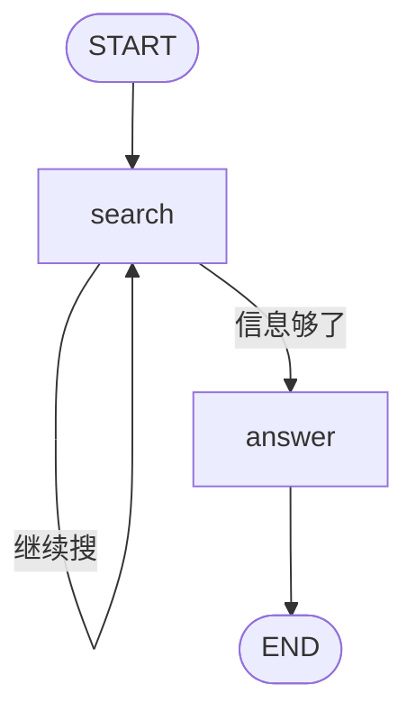
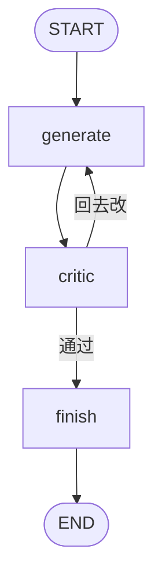

# 第 4 讲：两种循环——ReAct 工具循环 vs Executor+Critic

> 本系列用可运行的最小 demo 讲 LangGraph 实战。这是第 4 讲：Agent 干活最常见的两种「循环」——ReAct（思考→行动→观察）和 Executor+Critic（生成→评审→改写），一个靠工具驱动、一个靠评审驱动。配套 demo 见同目录 `research_assistant.py`。

**TL;DR**：Agent 的本质是循环。两种最常见的循环：**ReAct**（查资料：思考→行动→观察，反复直到信息够）和 **Executor+Critic**（写方案：生成→评审→改写，反复直到评审过）。本质区别在于「驱动循环的信号」——前者是"信息够不够"，后者是"质量过不过"。

---

## 正文

### §1 为什么 Agent 要「循环」

Agent 几乎都是以循环的方式落地的。看它的工作流程就明白：LLM 思考 → 调用工具（Tools / MCP Server）行动 → 环境反馈（运行结果、任务进度）作为观察回到上下文 → 优化下一轮思考。无论哪种范式的 Agent，都遵循这个「思考 → 行动 → 观察」的大体框架，所以 Agent 天然是循环。

既然是循环，就必须有「停下来的出口」。这个停止信号无非几类：**信息够了**（检索类，比如搜满 N 条）、**质量够了**（生成类，比如代码通过测试）、以及**撞上成本上限**（步数 / token 上限，这是所有循环的保险丝）。这一讲就对比前两种。

### §2 ReAct：思考 → 行动 → 观察

ReAct 是经典的三段式 Agent。**Reasoning** 指生成语言形式的推理轨迹，让模型能动态推理、制定并调整高层次计划；**Acting** 指与任务相关的动作，让模型与外部环境（比如维基百科）交互，把额外信息融进推理。落到 demo 里，「思考」就是判断"还要不要继续搜"（`should_keep_searching`），「行动」就是执行一次搜索（`search`），「观察」则是搜索结果写回 state：

```python
def search(state: ResearchState) -> dict:
    """「工具调用」：模拟一次搜索，追加一条结果。"""
    searches = state.get("searches", [])
    n = len(searches) + 1
    return {"searches": searches + [f"搜索{n}：关于「{state['query']}」的信息片段{n}"]}
```

注意：「观察」在 demo 里没有独立节点——`search` 的返回值直接落进 `searches`，这本身就是"观察回上下文"。信息够了之后，`answer` 才综合给出答案（那是循环结束后的收尾，不是观察）。

每一轮结束后，「继续转还是停」由 `should_keep_searching` 这个"思考"决定——demo 里是写死的规则（搜满 3 条就停），生产里这一步由真正的 LLM 判断。

「观察」之所以必须回上下文，是因为 LLM 要基于环境最新的反馈**修正下一轮推理**、做出更合理的下一步；否则它就只是在盲搜，不知道已经找到了什么。

### §3 Executor+Critic：生成 → 评审 → 改写

ReAct 靠「信息够了」停；Executor+Critic 靠「质量过了」停。这个循环里有两个角色：**Executor（执行者）**负责生成或改写一版方案，**Critic（评审者）**负责审这版方案、给出"过 / 继续改"的反馈。反馈打回给 Executor，它再改一版——如此往复，直到 Critic 通过。落到 demo 里，Executor 是 `generate`、Critic 是 `critic`：

```python
def generate(state: WritingState) -> dict:
    """Executor：生成 / 改写方案。第 1 次给初稿，之后按评审意见改一版。"""
    n = len(state.get("reviews", [])) + 1
    return {"draft": "方案初稿" if n == 1 else f"方案修订版 v{n}"}


def critic(state: WritingState) -> dict:
    """Critic：评审。demo 规则 = 改到 v3（评审两轮）才算过。"""
    reviews = state.get("reviews", [])
    n = len(reviews) + 1
    if n >= 3:
        return {"reviews": reviews + ["通过"]}
    return {"reviews": reviews + [f"评审{n}：还不完善，继续改"]}
```

「评审意见」走的是 state 里的 `reviews` 列表：`critic` 把每一条评审**追加**进去（累积，和第 1 讲 reducers 的 `add_messages` 同理），这就是"反馈回上下文"。demo 里 `generate` 只读 `reviews` 的**长度**（`n = len(reviews)+1`）判断"第几版、改到哪了"，是个规则模拟；生产里 Executor 会把 Critic 上一轮的评审原文真正读进上下文，**接着反馈往下改**——这才是这个循环和"一次性生成"的本质区别。

停止信号在 `should_continue`：

```python
def should_continue(state: WritingState) -> str:
    """评审通过 → 定稿；否则 → 回去改。"""
    return "finish" if state["reviews"][-1] == "通过" else "generate"
```

`critic` 一旦在 `reviews` 末尾写下"通过"，`should_continue` 就路由到 `finish` 定稿，循环结束。demo 里"通过"的门槛是写死的规则（改到 v3 放行），生产里是**真的 LLM 评审**——一个模型对照客观标准打分、给出"哪里不好"的具体意见。

这族循环在论文里有两个代表：**Self-Refine** 是"同一个模型自己生成、自己评审、自己改写"——自我反馈驱动迭代；**Reflexion** 在它基础上加了两样东西：**外部评估**（不靠模型自说自话，用测试/环境的客观信号判断好不好）和**记忆**（把每次失败的教训存成 episodic memory，下次不再犯同类错）。demo 是最朴素的 Self-Refine 形态：规则模拟的 Critic、无外部评估、无记忆。

### §4 两种循环的本质区别

两种循环的本质区别不在"要不要循环"，而在**驱动循环继续转的信号来自哪**——ReAct 的信号来自**外部环境反馈**，Executor+Critic 的信号来自**内部评审标准**。

落到 demo 里看信号落点。ReAct 的"继续搜/停"由 `should_keep_searching` 决定：

```python
def should_keep_searching(state: ResearchState) -> str:
    """「思考」：信息够了吗？demo 规则 = 搜满 3 次就够（真实项目是 LLM 判断）。"""
    return "search" if len(state.get("searches", [])) < 3 else "answer"
```

它读 `searches` 的**累积数量**——信号是外部工具反馈攒了多少条（"信息够不够"）。而 Executor+Critic 的"继续改/停"由 `should_continue` 决定：

```python
def should_continue(state: WritingState) -> str:
    """评审通过 → 定稿；否则 → 回去改。"""
    return "finish" if state["reviews"][-1] == "通过" else "generate"
```

它读 `reviews[-1]` 的**最新一条评审结论**——信号是内部评审的裁决（"质量过不过"）。一句话点透：一个在数"攒了多少"，一个在看"过没过"。

所以区分两种循环，看的**不是有没有"评审"节点，而是信号来源**。举个反例：一个循环里有个节点还叫 `critic`，但它读的是外部搜索工具的结果——那它本质是 ReAct 的"观察"环节换了个名字，不是 Executor+Critic。名字骗不了人，信号从哪来才决定范式。

最后补一个"身份"上的区别，也是很多人初看时的疑惑：ReAct 这种"工具循环"有官方现成封装——曾经是 `create_react_agent`（`langgraph.prebuilt`），**LangGraph v1 起已废弃**、统一到 LangChain 的 `create_agent`（配 middleware）；而 Executor+Critic 只是**模式**，至今没有现成工厂，要用 `StateGraph` 自己搭（就是 demo 的 `build_writing_graph`）。正因为一个有封装、一个没封装，生产里两者的升级路径也不同（§7 展开）。

### §5 组装：两张图的接线

循环的"回环"不是魔法，就是一条**条件边**把节点指回自己（或前面的节点）；而循环能安全存在的前提是——**它必须能终止**。下面分别看两张图的接线。

**ReAct 的回环：单节点自转。** `search` 之后挂条件边，路由函数 `should_keep_searching` 返回 `"search"` 时，path map 把它映射回 `search` 自己（继续搜）；返回 `"answer"` 时去收尾：

```python
def build_research_graph():
    g = StateGraph(ResearchState)
    g.add_node("search", search)
    g.add_node("answer", answer)
    g.add_edge(START, "search")
    # ReAct 的「循环」：search 之后由 should_keep_searching 决定「继续搜」还是「回答」
    g.add_conditional_edges("search", should_keep_searching, {"search": "search", "answer": "answer"})
    g.add_edge("answer", END)
    return g.compile()
```

关键映射就是 `"search": "search"`——这个自环就是 ReAct 循环的全部。一张图看明白：



**Executor+Critic 的回环：双节点互指。** `critic` 之后挂条件边，路由函数 `should_continue` 返回 `"generate"` 时，path map 把它指回 `generate`（再改一版）；返回 `"finish"` 时去定稿：

```python
def build_writing_graph():
    g = StateGraph(WritingState)
    g.add_node("generate", generate)
    g.add_node("critic", critic)
    g.add_node("finish", finish)
    g.add_edge(START, "generate")
    g.add_edge("generate", "critic")
    # Executor+Critic 的「循环」：critic 之后由 should_continue 决定「回去改」还是「定稿」
    g.add_conditional_edges("critic", should_continue, {"generate": "generate", "finish": "finish"})
    g.add_edge("finish", END)
    return g.compile()
```

关键映射是 `"generate": "generate"`——这个回环就是 Executor+Critic 循环的全部。两个节点来回转，如图：



对比一句：ReAct 一个节点自己转，Executor+Critic 两个节点来回转。差别在于——`should_keep_searching` 只做判断、不产出，所以它挂在条件边上、连节点都不是；`critic` 要产出评审意见并写回 `reviews`（有产出），所以必须是独立节点。一句话："思考"是轻量判断、挂在边上；"评审"是有产出的职责、必须独立成节点。

**循环必须能终止。** 两种循环的终止条件分别写在 `should_keep_searching`（读 `searches` 数量）和 `should_continue`（读 `reviews[-1]`）。如果条件永不满足，图会一直转到撞上 `recursion_limit`（默认 25 步）抛 `GraphRecursionError`。所以写 loop 的第一件事，就是确认**每一轮都推进了状态、最终能到达终止条件**——这和第 3 讲 §7 是同一个结论：循环可以转，但必须能自己停下来。

### §6 几个易混点（坑）

循环是双刃剑——三个坑：**停不下来、评不准、烧不起**。

**停不下来。** 最简单的兜底是设硬上限 `recursion_limit`（默认 25），但它只是"保险丝"——暴力跑满，可能没产出还烧 token。真正该做的是**设计终止条件**：及时捕捉"再跑也没用"的信号，该结束就结束。§5 说的"写 loop 先确认每轮推进状态、能到终点"，就是这条规范。

**评不准：Critic 要有客观标准。** 纯靠模型自评会"自说自话"——同一分布判断、生成与评判同标准、不可证伪、无外部落点，甚至把本来正确的改坏。给 Critic 客观的"过/不过"依据，来源有几类：

- **EM 精确匹配**（推理任务，与标准答案对齐）
- **预定义启发式**（如 AlfWorld 的重复动作 / 30 步规则）
- **环境完成信号**（环境本身就告诉你做没做成）
- **单元测试**（编译 / 解释器执行，编程任务）
- **独立 LLM Evaluator**（换模型 / 换 evaluator prompt 评判）

其中独立 LLM Evaluator 属于"半外部"——它打破了"生成和评判同标准"，比自评强，但仍不如环境信号（单测、EM）硬。注意：外部评估不只"判对错"，还决定"什么时候停"。

**烧不起：token 消耗不低。** 循环每一轮都要把**完整轨迹**喂回上下文，上下文逐轮膨胀——第 N 轮成本 O(N)，跑 N 轮总成本 O(N²)，不是"多转几轮多付几轮"；而且长前缀会打穿 prompt cache。demo 用规则模拟、没这个成本，生产里这就是真金白银。

### §7 生产化延伸

demo 用规则模拟"思考/评审"，是为了**把循环机制讲清楚、且不依赖 LLM**（clone 下来就能跑）；生产里这些模拟要换成真 LLM + 高层封装，代价和坑也随之放大。

**ReAct 生产版：`create_agent`。** demo 里手写了整套循环接线——`add_node`、`add_conditional_edges`、path map、`add_edge("answer", END)`。生产里这套可以省掉：官方把 ReAct 工具循环封装成了 `create_agent`——注意它是 **LangChain 的接口**（`from langchain.agents import create_agent`）、底层跑在 LangGraph 上；老的 `create_react_agent`（`langgraph.prebuilt`）在 LangGraph v1 已废弃。`create_agent` 的循环终止默认是"response 里不再有 tool_calls"（模型不再调工具就停）。代价是控制权转移到了 middleware——`create_agent` 的卖点正是 middleware 可定制；默认停止条件是固定的，要"搜满 3 条就停"这种自定义，得写 middleware、或退回裸 StateGraph。

**Executor+Critic 生产版：升级成 Reflexion / Self-Refine。** demo 的 Critic 是写死的规则，生产里要换成真 LLM 评审 + 客观标准（§6 那五类来源）。更进一步的升级是 **Reflexion**——它在 Self-Refine 基础上加了两样：**外部评估**（§6 已讲）+ **记忆**。这个记忆分两层：**短期记忆**是当前 trial 的轨迹 τ（细粒度、近期的动作序列）；**长期记忆**是 self-reflection 模型产出的反思文本 sr_t（蒸馏过的、跨 trial 的经验教训）。所以 Reflexion 的"策略" = 冻结的 LLM 权重 + 这块可读写的外部记忆——这正是它"用语言做强化学习、不动权重"的落点：权重不变，变的是记忆内容。记忆的两个作用：一是**纠错**（把长轨迹开头那个错误拎出来），二是**积累经验做穷举搜索**（记着哪些抽屉已翻过，下次不再试）。

**诚实边界。** demo 用规则模拟"思考/评审"，clone 就能跑、零 API 成本；生产里这些是 LLM 调用，判断标准和 token 成本都真实存在，§6 的三个坑全被放大，需要系统调优。

### §8 总结

Agent 干活最常见的两种循环——ReAct 靠"信息够了"停（对外）、Executor+Critic 靠"质量过了"停（对内），一个工具驱动、一个评审驱动。循环的底线是：**必须有一个"能停下来的出口"**。最后以两道常见面试题收尾：

**面试题一：ReAct vs Executor+Critic 的区别。**
- 一句话：本质区别是"驱动循环的信号来自哪"——ReAct 来自**外部工具反馈**，Executor+Critic 来自**内部评审标准**（§4）。
- 适用场景：查资料 / 信息检索 → ReAct；写方案 / 对质量要求高的生成 → Executor+Critic。

**面试题二：循环怎么防死循环（三件套）。**
- **设计终止条件（主，§5）**：写 loop 的第一件事，是确认每轮都推进了状态、最终能到终点——这是让循环"自己停下来"的正解。
- **`recursion_limit` 兜底（保险，默认 25）**：保险丝，防的是"终止条件没写好"时烧穿，不能反过来依赖它当出口。
- **客观标准（评审循环特有，§6）**：Critic 要有客观依据，否则要么永远打回（真死循环）、要么橡皮图章（假通过）。

---

## 参考文献

1. **LangGraph v1 发布说明（`create_react_agent` 废弃）** — <https://docs.langchain.com/oss/python/releases/langgraph-v1>
2. **LangChain 官方博客《Reflection Agents》** — <https://www.langchain.com/blog/reflection-agents>
3. **学术：ReAct《ReAct: Synergizing Reasoning and Acting in Language Models》** — <https://arxiv.org/abs/2210.03629>
4. **学术：Reflexion《Reflexion: Language Agents with Verbal Reinforcement Learning》** — <https://arxiv.org/abs/2303.11366>
5. **学术：Self-Refine《Self-Refine: Iterative Refinement with Self-Feedback》** — <https://arxiv.org/abs/2303.17651>
6. **腾讯云《从零构建能自我优化的AI Agent：Reflection和Reflexion机制对比详解与实现》** — <https://cloud.tencent.cn/developer/article/2588362>
7. **知乎《AI Agent模式全景图：从ReAct到Multi-Agent的演进之路》** — <https://zhuanlan.zhihu.com/p/1968071452067620000>

---

完整代码：[`research_assistant.py`](https://github.com/wanghesong2019/langgraph-in-action/blob/main/04-react-vs-executor-critic/research_assistant.py)
