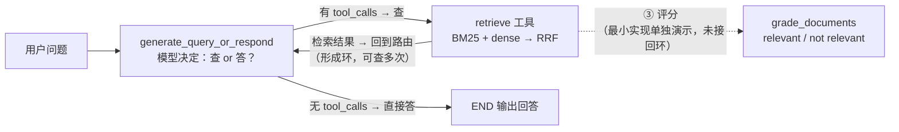

# 第 6 讲：RAG 检索优化——分词坑 → 混合检索 → 生产化落地

> 本系列用可运行的最小 demo 讲 LangGraph 实战。这是第 6 讲：RAG 的检索层——怎么让"召回"又准又全。两条主线：① **中文分词坑**（BM25 若按空格切，中文没空格 → 整句一个 token → 召回崩，换 jieba 恢复）；② **混合检索**（dense 语义 + BM25 关键词，用 RRF 融合）。

**TL;DR**：检索召回有两类信号——**关键词**（BM25，靠精确匹配）和**语义**（dense embedding，靠向量相似）。单靠任一种都有盲区：BM25 漏同义词、dense 漏精确词。正解是**混合检索**：两者各自召回 top-k，再用 **RRF**（Reciprocal Rank Fusion，`Σ 1/(k+rank)`）融合。另一个坑：中文没空格，BM25 先 jieba 分词才能匹配到词。

---

## 正文

### §1 为什么需要检索（RAG 的地基）

LLM 有先天局限（上下文有限 + 知识固化），retrieval 在查询时抓取相关外部知识来补上——这是 RAG 的地基。语义检索用 embedding 把文本变成"语义坐标"、靠相似度度量相关性，是最主流的一种。

**① LLM 的两个局限 → 检索为什么是地基。** LLM 的上下文窗口有限，装不下整个语料库；而检索只从语料库中抓取和用户问题相关的文档块，规避了长度限制。LLM 的训练数据有截止日期，导致知识固化；检索则能拿到训练截止之后的外部最新知识。RAG 的 "R" 就是 Retrieval（检索），所以检索是整个 RAG 流程的地基。

**② embedding：把文本变成"语义坐标"。** embedding 模型把文本映射成高维向量，文本语义越相近、向量越相似。常用的相似度度量有：余弦相似度 / 点积 / 欧氏距离（归一化向量上余弦 ≈ 点积）。

**③ 最小语义检索链路。** 文档加载 → 切块 → embedding → 向量库 → 查询向量检索 → 结果喂 LLM。稍后会用 demo 把这条链路一步步实现并调优。

### §2 基础实现 baseline：BM25 + 按空格切（暴露中文坑）

先交代本文唯一的指标——**Recall@k**：每条查询标注了它真正相关的文档，只要相关文档进了检索结果前 k 名就算命中，`Recall@3` = 命中查询数 ÷ 总查询数（demo 共 5 条查询，下文 Recall 都指 Recall@3）。

**① baseline 用空格切，暴露中文坑。** baseline 用"英文式按空格切"处理中文文档——按空格切，中文整句被当成**一个 token**，BM25 词项匹配全部落空，Recall = 0.00。这一步暴露了**"中文检索必须先分词"**这个前置条件。代码如下：

```python
def space_tokenize(text: str) -> list[str]:
    """baseline 的错误分词：按空格切。中文没空格 → 整句一个 token。"""
    return text.split()

def bm25_search(query: str, tokenize: Callable, k: int = 3) -> list[int]:
    """返回与 query 最相关的 top-k 个文档下标。"""
    tokenized_docs = [tokenize(d) for d in DOCS]
    bm25 = BM25Okapi(tokenized_docs)
    scores = bm25.get_scores(tokenize(query))
    if max(scores) <= 0:  # 没有任何词命中 → 诚实返回空，而不是靠稳定排序硬凑 top-k
        return []
    ranked = sorted(range(len(DOCS)), key=lambda i: scores[i], reverse=True)
    return ranked[:k]
```

**② 为什么 Recall = 0.00。** 中文没空格，`space_tokenize()` 把整句切成一个 token；而 BM25 按词项匹配——query 的 token 和每个 doc 的 token 都对不上，分数全 0。`if max(scores) <= 0: return []` 这句是诚实返回空，防止"稳定排序硬凑 top-k"的假命中。

**③ BM25 的信号 = 词项精确匹配。** 它是字面匹配、不是语义：擅长精确词（ID、专有名词），不擅长同义词/改写。既然问题是"没分词"，下一节就先修分词器，看效果会不会回升。


### §3 优化①：换 jieba 分词 → Recall 回升

**① 只改一个组件：分词器。** 把 `space_tokenize` 换成 `jieba_tokenize`（jieba 分词 + 停用词过滤），让 BM25 恢复"按词匹配"。看 Recall 会不会回升：

```python
def jieba_tokenize(text: str) -> list[str]:
    """优化①：jieba 中文分词 + 过滤停用词。"""
    return [w for w in jieba.cut(text) if w.strip() and w not in STOPWORDS]
```

**② 两个改动各起什么作用。** 相比按空格切分，`jieba.cut` 把整句切成一个个词——解决"整句一个 token"的问题，BM25 有了可匹配的"词项"；`STOPWORDS` 过滤掉"的/我/如何"这类高频噪声词，防止它们导致假命中、保证召回的真实性。

**③ 结果。** 换成 jieba 后 Recall 从 0.00 → 0.80（5 条中 4 条命中）。漏的是"如何拿回我的钱"——它和"退款政策"没有共享词，这是**关键词匹配的天花板**：关键词匹配管不了"无共享词的同义表达"。下一节加语义（dense）补上。

### §4 优化②：加 dense（BGE-M3 embedding）

**① 只加一个组件：向量检索（dense）。** 在 BM25 之外加一条 BGE-M3 的向量检索链路，专补 BM25 漏掉的"无共享词但语义等价"的查询。代码如下：

```python
BGE_QUERY_INSTRUCTION = "为这个句子生成表示以用于检索相关文章："

def build_embeddings() -> OpenAIEmbeddings:
    """OpenAI 兼容的 embedding 客户端，指向 BGE-M3 的 vLLM 服务。"""
    api_key = os.environ.get("EMBED_API_KEY")
    if not api_key:  # 新版 openai SDK 不接受空 api_key，缺 key 时清晰报错
        raise ValueError("请先设置 EMBED_API_KEY 环境变量（33-server BGE-M3 vLLM 的共享 key）")
    return OpenAIEmbeddings(
        model=os.environ.get("EMBED_MODEL", "BAAI/bge-m3"),
        base_url=os.environ.get("EMBED_BASE_URL", "http://127.0.0.1:8011/v1"),
        api_key=api_key,
    )

def _cos(a, b):
    na = math.sqrt(sum(x * x for x in a)); nb = math.sqrt(sum(y * y for y in b))
    return sum(x * y for x, y in zip(a, b)) / (na * nb)

def dense_search(query: str, embeddings: OpenAIEmbeddings, k: int = 3) -> list[int]:
    """向量余弦相似度检索 top-k。"""
    qv = embeddings.embed_query(BGE_QUERY_INSTRUCTION + query)   # query 侧加前缀
    dvs = embeddings.embed_documents(DOCS)                       # 文档侧不加
    sims = [_cos(qv, dv) for dv in dvs]                          # 余弦相似度
    return sorted(range(len(DOCS)), key=lambda i: sims[i], reverse=True)[:k]
```

**② 为什么 dense 能补上 BM25 的洞。** embedding 把文本映射成高维向量，模型靠对比学习训练成"语义相近 → 向量相近"（BGE-M3 论文训练方法节）：训练时把 (query, 相关文档) 正样本对拉近、负样本推远。所以 embedding 学的是"概念"而不是"字面"——"拿回钱"和"退款"零共享词，但指向同一个语义方向，向量自然靠近。这正是 BM25 做不到的：它靠词项匹配，碰到零共享词就漏。

**③ 结果。** dense 单独 Recall 0.60（5 条命中 3 条）：抓到了 BM25 漏掉的"如何拿回我的钱 → 退款"，还有"怎么退款""会员没到账"。

**④ 但 dense 也有新盲区。** 看两个具体查询：问"密码忘了怎么找回"（真正相关的是"账号密码重置"），dense 的 top-3 却是 [会员到账说明、退款政策、电子发票]，唯独没有"密码重置"；问"优惠券能用吗"（真正相关的是"优惠券使用规则"），dense 返回的还是同样三条。五条查询的 dense top-3 全是同一个 `[1,0,3]`。原因：8 条语料全是客服文档、语义高度重叠，dense 分不清"密码""优惠券"这些具体诉求，塌缩成"哪几条最像客服文档就返回哪几条"。短文档 + 语义重叠 → 排序塌缩，这是 dense 的固有盲区，得靠关键词检索补。

**⑤ 顺带一提：BGE-M3 的 query 指令前缀（坑）。** 官方说法是 BGE-M3 "trained without query prompt"（不加前缀也能用，见 LangChain《BGE on Hugging Face》），但 demo 短查询实测：不给 query 加前缀时，"如何拿回我的钱"的余弦是 退款 0.32 < 物流 0.42（排错），加前缀后变成 退款 0.68 > 物流 0.36（纠正）。所以前缀是"按任务 opt-in"的——官方不强制，但短查询场景实测有帮助。`BGE_QUERY_INSTRUCTION` 干的就是这个。

dense 漏的（密码/优惠券）和 BM25 漏的（拿回钱）不是同一条——这正是下一节把它们融合起来能到 1.00 的前提。

### §5 优化③：RRF 融合 dense + BM25 → 混合检索

**① 只加一个组件：融合策略（RRF）。** 把 BM25 关键词检索和 dense 语义检索的两条 top-k 合成一条，补上各自的盲区。代码如下：

```python
def rrf_fuse(*rank_lists: list[int], k: int = 60, top_k: int = 3) -> list[int]:
    """Reciprocal Rank Fusion：score(d) = Σ 1/(k + rank_i(d))。"""
    scores: dict[int, float] = {}
    for ranks in rank_lists:
        for rank, doc_id in enumerate(ranks):
            scores[doc_id] = scores.get(doc_id, 0.0) + 1.0 / (k + rank + 1)
    return sorted(scores, key=lambda i: scores[i], reverse=True)[:top_k]
```

**② RRF 怎么算、为什么用排名。** 公式是 `score(d) = Σ 1/(k + rank)`，`rank` 是 1 起排名（代码里 `enumerate` 从 0 起、`rank + 1` 转成 1 起，所以排第 1 得 `1/61`）。它只读每条列表里的**排名**、不读原始分数。为什么不用分数？因为 BM25 分数无上限、dense 余弦在 0~1，量纲完全不同、直接相加不可比；排名无量纲，可以跨两种检索器融合。

**③ 互补：漏的不重叠。** bm25 漏「如何拿回我的钱」（dense 的 `[1,0,3]` 里含 0，兜住）、dense 漏「密码忘了」「优惠券」（bm25 靠精确词兜住），两边漏的不是同一条，融合后 5 条全中。

**④ 结果。** 两个单检索器各自 Recall@3：BM25 0.80、dense 0.60；RRF 融合后 **1.00**。到这一步，"混合检索 = 关键词精确 + 语义泛化、两者互补"就闭环了。四步一目了然：

| 步骤 | 改动 | Recall@3 |
|---|---|---|
| baseline | BM25 + 按空格切（没分词） | 0.00 |
| 优化① | 换 jieba 分词（BM25 单检索） | 0.80 |
| 优化② | 加 dense（dense 单检索） | 0.60 |
| 优化③ | RRF 融合两者（混合检索） | 1.00 |

### §6 生产工程化：从手写 RRF 到官方 EnsembleRetriever

前五节把 Recall 从 0.00 拉到 1.00，但那是"一次性脚本"的写法——每一步都是现算现用。真上生产，还差两处工程化：**① 索引持久化**（别每次查询都重算 embedding）；**② 用官方 `EnsembleRetriever` 替代手写 `rrf_fuse`**。Recall 不变（还是 1.00），补的是"能上生产"的形态与边界。

**① 索引持久化：embed 一次存库，别每次查询重算。**

demo 的 `dense_search`（§4）每次查询都会执行 `dvs = embeddings.embed_documents(DOCS)`，把 8 条文档向量重算一遍。查询量一上来，这就是重复的 embedding 调用——embedding 服务按调用/token 计费，烧算力也烧钱。

生产做法：**建一次库 → 落盘 → 之后复用**。以 FAISS 为例：

```python
from langchain_community.vectorstores import FAISS

vectorstore = FAISS.from_texts(DOCS, embeddings)   # 建库：embed 一次
vectorstore.save_local("./faiss_index")            # 落盘

# —— 之后每次查询：加载复用，不再重算 ——
vectorstore = FAISS.load_local(
    "./faiss_index", embeddings,
    allow_dangerous_deserialization=True,          # load_local 用 pickle，需显式允许
)
docs = vectorstore.similarity_search(query, k=3)
```

收益有两层：一是**省 embedding 调用**——从"每查询 N 次"降为"建库时 N 次 + 每次查询 1 次"，最实在（计费就在这一项）；二是**查询快**——但只在数据量大时体现（FAISS 用 IVF/HNSW 索引做近似近邻，比逐个 `_cos` 快几个量级；demo 就 8 条，这层收益看不出）。

诚实边界（三点都要心里有数）：① FAISS 是**单机内存**索引，`save_local` 只是把索引序列化落盘（`index.faiss` + pickle 的 docstore），**不是分布式**——数据量超出单机内存、或多机要共享时，得换 Milvus/Chroma 这类真·向量库；② **文档更新时索引不会自动跟随**，源文档改了要重建或增量更新索引，否则向量库和源文档不同步、召回的仍是旧知识；③ `load_local` 内部走 pickle 反序列化，那个 `allow_dangerous_deserialization=True` 是绕不开的安全闸门——它提醒你"反序列化不可信文件有风险"。

> 注：LangChain 现已把 FAISS 封装拆成独立包 `langchain-faiss-vectorstore`（本讲引用即它的 PyPI 页），API 与 `langchain_community.vectorstores.FAISS` 一致（`from_texts` / `save_local`）。

**② 官方 `EnsembleRetriever` 替代手写 `rrf_fuse`。**

demo 手写的 `rrf_fuse`（§5）与 LangChain 官方源码并列对照：

```python
def rrf_fuse(*rank_lists: list[int], k: int = 60, top_k: int = 3) -> list[int]:
    """手写版：score(d) = Σ 1/(k + rank_i(d))。"""
    scores: dict[int, float] = {}
    for ranks in rank_lists:
        for rank, doc_id in enumerate(ranks):        # rank 从 0 起
            scores[doc_id] = scores.get(doc_id, 0.0) + 1.0 / (k + rank + 1)
    return sorted(scores, key=lambda i: scores[i], reverse=True)[:top_k]
```

```python
# 官方源码（retrievers/ensemble.py）weighted_reciprocal_rank 的核心循环
rrf_score: dict[str, float] = defaultdict(float)
for doc_list, weight in zip(doc_lists, self.weights, strict=False):
    for rank, doc in enumerate(doc_list, start=1):   # rank 从 1 起
        rrf_score[
            doc.page_content if self.id_key is None else doc.metadata[self.id_key]
        ] += weight / (rank + self.c)                 # c 默认 60
```

对照三点：

- **公式**：手写是 `1/(k+rank+1)`（0 起 rank），官方是 `weight/(c+rank)`（`start=1` 起 rank，`c` 默认 60）。`weights` 全为 1 时两者**逐项等价**——rank 1 都拿 `1/61`，只是"0 起 + `rank+1`"和"1 起"两种写法。
- **加权**：官方多了 `weights`，让你按"哪个信号更可信"调。文档短且语义重叠 → dense 塌缩（§4 已证 `[1,0,3]`）→ 给 BM25 更高权重；改写/近义词多 → 给 dense 更高。**判断依据是带标注的评测集**（就是 demo 的 `QUERIES` + 相关文档标注）——在评测集上扫权重、最大化 Recall@k，用 Recall 说话，别拍脑袋。
- **用法**：把 BM25 和 FAISS 两条 retriever 挂到一起，一行组装：

```python
from langchain.retrievers import EnsembleRetriever

ensemble = EnsembleRetriever(
    retrievers=[bm25_retriever, faiss_retriever],
    weights=[0.5, 0.5],        # 默认等权，按评测集调
)
```

- **`c` 的作用**：调"榜首 vs 尾部"的平衡旋钮——`c` 越大越"民主"（排名靠前的优势被缩小），`c` 越小越看重榜首（优势放大）。

### §7 组装进 LangGraph：agentic RAG

§6 把检索补成了"能上生产"的形态（索引持久化 + 官方 `EnsembleRetriever`）。但前几节——包括 §6——都还是"查询 → 检索 → 生成"的一条直线，检索是固定、被动的步骤。真实用户的问题未必一次检索就够：有时要查多次、有时要把问题改写成更适合检索的 query、有时检索回来的文档不相关得重查。这就是 **agentic RAG**：把检索变成 agent 里的一个工具，让"要不要查、查什么、查几次"由 agent 自己决定（LangGraph 官方文档《Build a custom RAG agent》，见参考文献 #2）。

**① 检索变工具：`retrieve` 是个 `@tool`。** §5 的混合检索（BM25 + dense → RRF）本来是一个函数，agentic RAG 里把它包成 `@tool`：

```python
@tool
def retrieve(query: str) -> str:
    """检索产品帮助中心文档，返回与 query 最相关的文档片段。"""
    return hybrid_search(query)   # 就是 §5 的 BM25 + dense → RRF
```

变了什么：检索从"无条件前置步骤"变成"agent 按需调用的工具"——**要不要查、用什么 query 查、查几次，都由 agent 定**。demo 里用户问"会员没到账怎么办"，agent 实际调用 `retrieve` 的 query 是"会员购买后未到账怎么办"——它把问题**改写**成了更适合检索的表达，这是"改写 query"的实锤。

**② 路由节点：`generate_query_or_respond`。** 这一步用 **tool calling**（和第 5 讲结构化输出同一个机制）逼模型二选一：调用 `retrieve` 去查，或直接回答：

```python
def generate_query_or_respond(state: MessagesState) -> dict:
    model = build_model().bind_tools([retrieve])     # 把 retrieve 作为可调工具
    response = model.invoke([SystemMessage(SYSTEM_PROMPT)] + state["messages"])
    return {"messages": [response]}

def route(state: MessagesState) -> str:
    last = state["messages"][-1]
    if getattr(last, "tool_calls", None):            # 模型要调 retrieve
        return "retrieve"
    return END                                       # 直接回答 → 结束
```

关键在图里那条 `retrieve → 回到 generate_query_or_respond` 的边：检索完又回到路由节点，形成**环**——模型可以查一次、查多次，也可以不查直接答。这就和 §1–§6 的"一条直线"分道扬镳了：



**③ `grade_documents`：给检索结果打分（补 precision）。** 检索器靠**相似度**排序，但相似度 ≠ 相关；`grade_documents` 用 LLM 给每条文档打 relevant/not relevant，补的是"召回对不对"（precision，而 §6 解决的是"召回全不全"）。demo 对"会员没到账"检索回来的三条打分：会员到账说明 = yes、退款政策 = no、客服联系方式 = yes。最小实现只演示打分；完整 **corrective RAG**（检索后先评分、评分不合格就改写 query 再查的进阶 RAG）会把"全不相关 → 改写 query 再查"这条边接回环里。

**④ 诚实边界。** agentic RAG 更灵活，但更贵（多轮 LLM 调用：生成 query + 评分 + 生成回答）且更难控（模型可能反复检索、超时超预算）。demo 场景简单、问题单一，一条直线 RAG 就够；agentic 是"问题复杂、需要多跳/多查"时才上——别为"高级"而硬上。

### §8 总结 + 面试题

一句话收尾：RAG 的检索层有两类信号——**关键词**（BM25 精确匹配）和**语义**（dense 向量相似），单靠任一个都有盲区；正解是**混合检索**：各自召回 top-k，再用 **RRF**（`Σ 1/(k+rank)`）按排名融合。中文场景还有一个前置坑：先 jieba 分词，BM25 才匹配得到词。

三道高频面试题：

**「为什么混合检索比单检索好？」** BM25 是字面匹配，擅长精确词（ID、专有名词），漏同义词/改写；dense 是语义匹配，但文档短、语义重叠时排序退化（demo 里 5 条查询的 dense top-3 塌缩成同一个 `[1,0,3]`，漏"密码/优惠券"）。关键是**两边漏的不是同一条**：BM25 漏"如何拿回我的钱"（和"退款"无共享词），dense 靠语义兜住；dense 漏精确词，BM25 靠词项兜住。RRF 融合取长补短，Recall 从单检索的 0.80 / 0.60 提到 1.00。

**「中文检索为什么要分词？」** 中文没有空格。若按空格切（英文式做法），整句会被当成**一个 token**，BM25 的词项匹配全部落空——demo baseline 的 Recall 就是 0.00。jieba 分词把整句切成一个个词，BM25 才有词项可匹配，Recall 回升到 0.80；顺带用停用词过滤"的/如何"这类噪声词，防止假命中。

**「RRF 怎么算？」** `score(d) = Σ_i weight_i / (k + rank_i(d))`：`rank_i(d)` 是文档 d 在第 i 个检索器结果里的**排名**（从 1 起），`k` 是常数（默认 60），`weight_i` 是第 i 个检索器的权重（默认 1）。它**只读排名、不读原始分数**——因为 BM25 分数无上限、dense 余弦在 0~1，量纲不可比，而排名无量纲，可以跨检索器融合。demo 手写 `rrf_fuse` 是 0 起 rank 的 `1/(k+rank+1)`，和官方 1 起 rank 的加权 RRF 等价。

---

## 参考文献

1. **LangChain 官方文档《Build a semantic search engine with LangChain》** — <https://docs.langchain.com/oss/python/langchain/knowledge-base>
2. **LangGraph 官方文档《Build a custom RAG agent with LangGraph》** — <https://docs.langchain.com/oss/python/langgraph/agentic-rag>
3. **LangChain 官方源码《EnsembleRetriever》（`retrievers/ensemble.py`）** — <https://github.com/langchain-ai/langchain/blob/master/libs/langchain/langchain_classic/retrievers/ensemble.py>
4. **LangChain 官方文档《FAISS》（`langchain-faiss-vectorstore` 包）** — <https://pypi.org/project/langchain-faiss-vectorstore/>
5. **deepagents 官方文档《Retrieval》** — <https://docs.langchain.com/oss/python/deepagents/retrieval>
6. **BGE-M3 论文《BGE M3-Embedding: Multi-Lingual, Multi-Functionality, Multi-Granularity Text Embeddings Through Self-Knowledge Distillation》**（arXiv:2402.03216）— <https://arxiv.org/abs/2402.03216>
7. **LangChain 官方文档《BGE on Hugging Face》** — <https://docs.langchain.com/oss/python/integrations/embeddings/bge_huggingface>

---

完整代码：[`doc_qa.py`](https://github.com/wanghesong2019/langgraph-in-action/blob/main/06-rag-hybrid-retrieval/doc_qa.py)（§1–§6 检索）· [`agentic_rag.py`](https://github.com/wanghesong2019/langgraph-in-action/blob/main/06-rag-hybrid-retrieval/agentic_rag.py)（§7 agentic RAG）
