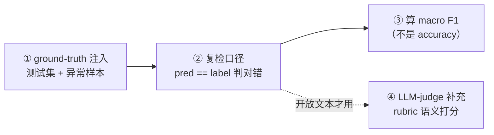

# 第 7 讲：Agent 评测——ground-truth 注入 + 复检口径

> 本系列用可运行的最小 demo 讲 LangGraph 实战。这是第 7 讲：怎么评测一个 Agent 好不好——不是"再写一个 Agent"，而是给它一套带真值的测试集（含异常样本），跑一遍，按写死的口径判定对错，算 F1。

**TL;DR**：Agent 比单个 prompt 复杂得多（LLM + 工具 + 流程），不评就不知道它准不准、改一处会不会退化。评测四步：① **ground-truth 注入**（带真值标注的测试集，务必混入异常样本）；② **跑 Agent**；③ **复检口径**（写死判定对错的标准：标签精确匹配 + 异常样本规则）；④ **算 F1**（别只看 accuracy）。

---

## 正文

### §1 为什么要评测 Agent

Agent 是 LLM + 工具 + 流程（状态/路由/循环）的复合体，比"单个 prompt"复杂得多：改一处（prompt / 工具 / 模型 / 流程），就可能让原本配合良好的整体退化。而**单次运行只走一条路径**——条件分支、循环没覆盖全，改动的组件可能根本没被执行到——所以退化往往察觉不到。这是"要评测"的第一层理由：不评，就不知道它到底好不好（LangChain《Agent Evals》，见参考文献 #1）。

**① 评什么：正确性 + 过程/效率。** 至少两个维度：一是**正确性**——最终结果对不对（demo 里就是分类标签准不准）；二是**过程/效率**——执行轨迹里 token 有没有浪费、工具调用对不对、执行成功率、流程延迟。只看最终答案会漏掉后者：一个"答案对但中途多绕几圈"的 Agent 和"干净利落答对"的 Agent，最终结果一样，成本和风险却完全不同。

**② 为什么评 trajectory 而非最终答案。** trajectory = 消息 + 工具调用序列，保留了"过程"。最终答对 ≠ 过程对——Agent 可能调错了工具、多绕了几圈才碰巧答对。评 trajectory 能：**诊断**（看出"调错工具 / 多绕几圈"这类过程问题，给出优化证据）+ **回归检测**（改一处后 trajectory 变了即报警，不用等最终答案出错才发现）。

**③ integration test vs eval。** 二者分工不同：integration test 查"跑得通、不崩"（接线对不对），**不看结果对不对**；eval 查"行为对不对"（和 ground-truth 比对）。本讲 demo 算了 F1（拿预测和 ground-truth 比对正确性），所以它是 **eval**，只是**最简化的 eval**——只评最终分类标签，不评 trajectory / 工具调用序列。

评测一个 Agent 的四步，下面 §2–§5 就沿这条线展开：



### §2 ground-truth 注入（测试集 + 异常样本）

评测的第一步是明确"喂什么"——一个带真值标签的测试集。

**① 真值标签是第一前提。** 标签一般人工标注 + 多轮复核；标签的真实性和准确性是第一前提——标签错了，评测结果就全盘不可信（F1 衡量的变成了"和错误真值的一致性"）。

**② 样本要有代表性 + 覆盖度。** 在标签正确的前提下，样本主题要是真实场景会出现的（电商场景下用户真的会发的留言 / 评论）；除正常样本外，还要覆盖**异常样本**（空文本、乱码、无关话题）。

**③ 注入异常样本：测 Agent 识别异常的能力。** 不注入，评测就发现不了 Agent 在 OOD 上的脆弱性。异常怎么纳入评测？从数据和 Agent 两方面入手：
- **数据侧**：异常样本打标签时直接归到 `other`（表明它不属于任何一个业务类别）。
- **Agent 侧**：结构化输出 schema 里加 `other` 兜底类，给 Agent 一个表达"这是异常"的出口——否则异常样本必然全错，或程序直接报错（`evaluate()` 里 `LABELS` 没有 `other` 会 KeyError）。

**④ 故意不平衡埋线。** demo 把 billing 做成 8 条多数类，为 §4 对比 accuracy 和 F1 备好数据。

### §3 复检口径（标签精确匹配 + 异常样本规则）

复检口径，本质就是**判定 Agent 输出对错的标准**，必须事先写死，否则结果不可比、不可复现、不可信。

**① demo 的口径：`pred == label`（标签精确匹配）。** 只有分类标签完全一致才算命中，是较严格的口径。LangChain 的 Trajectory match evaluator 里有 strict / unordered / subset / superset 等不同严格度的命中口径——本质都是"怎么算命中"的松紧不同。

**② 口径有严格度，别为刷分放宽。** 放宽口径（比如"退款/售后相关就算对"）会让指标虚高——这只代表口径变松了，不代表 Agent 真的变好。口径的严格程度要**贴近真实业务对错**，不能为了数字好看而放宽。

**③ 异常样本规则：被 `pred == label` 天然覆盖。** 异常样本真值记 `other`，Agent 硬分类到业务类就记作误报；这个误判在混淆矩阵里**记两处**——对业务类是 FP，对 `other` 类是 FN。它不是额外规则，而是 `pred == label` 自然涵盖的（异常真值就是 other）。

### §4 算 F1（不是 accuracy）

**① 三个指标 + 公式。** precision = TP/(TP+FP)（判为该类的里，多少真属于该类）；recall = TP/(TP+FN)（该类的里，多少被正确召回）；F1 是两者的调和平均（`2PR/(P+R)`），precision 或 recall 任一拉胯，F1 都会被拽低。退化基线算一遍：billing 类 TP=8、FP=4、FN=0 → precision 8/12≈0.67、recall 1.0、F1 0.80；tech 类 TP=0、FN=1（那条 tech 被基线猜成 billing，漏报）→ recall=0、F1=0。

**② 为什么 accuracy 骗人。** accuracy = 正确预测数 / 总样本数，本质是**按样本数加权**——哪个类样本多，哪个类就在 accuracy 里占大头。退化基线里 8 条 billing 全猜中，光这一项就贡献 8/12=0.67 的 accuracy，看着"及格"。而 macro F1 = 逐类 F1 取平均，**按类别平权**——每类固定 1/4 权重，少数类的 F1=0 会实实在在地把 macro 拉到 0.20。所以"猜多数类"能骗过 accuracy，骗不过 macro F1。

**③ macro vs micro：为什么 micro F1 数值上等于 accuracy。** micro 是先把所有类的 TP/FP/FN 加总、再算一个全局 F1；macro 是逐类 F1 取平均。关键在"**判错记两笔**"：一个样本真值是 `billing`、被预测成 `tech`，它对 `tech` 是 FP、对 `billing` 是 FN——所以每判错 1 个样本，全局 FP +1、全局 FN +1；每判对 1 个，全局 TP +1。于是全局 TP = 判对数、全局 FP = 全局 FN = 判错数，代入公式：

```
micro precision = 全局TP/(全局TP+全局FP) = 判对/(判对+判错) = accuracy
micro recall    = 全局TP/(全局TP+全局FN) = 判对/(判对+判错) = accuracy
micro F1        = 二者的调和平均 = accuracy
```

直觉上，micro 就是"不分类别地数判对了几个"，这正是 accuracy 的定义，所以它和 accuracy 一样被多数类主导。退化基线验证：12 条判对 8 条，accuracy = micro F1 = 8/12 = 0.67，而 macro F1 = 0.20。**要类别平权、在乎小类/异常类，选 macro**；只关心整体大盘（各类样本数就是真实分布），才用 micro。

### §5 LLM-judge 补充（生产化）

**① 什么时候要 LLM-judge。** 生成式 / 开放文本输出场景，模型输出与参考答案往往**语义等价但字面不同**，确定性口径（`pred == label`）会把"答对了意思、措辞不同"判成错。分类 / 结构化输出（标签、字段）用确定性口径就够；只有内容质量、语义对不对需要 LLM-judge。

**② LLM-as-judge 怎么工作。** judge LLM + rubric（评分细则）→ 定性打分（连续分）。预置 prompt 有 correctness（判对不对）、hallucination（判有没有幻觉）等；分 reference-based（给参考答案，judge 比对着判）和 reference-free（不给，只凭 rubric 判）。它**不需要参考轨迹**——这是它和 trajectory match 的关键区别：一个判"语义质量"，一个判"过程是否按预期走"。

**③ 三个 bias + 缓解。**
- **position（位置偏差）**：裁判偏爱某个出现顺序（pairwise 里换顺序胜负可能反转）→ 随机化顺序、两次评估取一致。
- **verbosity（冗长偏差）**：裁判偏爱更长回答，即使啰嗦跑题 → rubric 写"重内容轻篇幅"、单独评 conciseness、长度惩罚。
- **self-enhancement（自我增强）**：裁判偏爱同家族 / 自己生成的输出 → 裁判与生成模型解耦、多模型裁判团、人工黄金集校准。

**④ 诚实边界。** 本 demo 是分类任务，确定性口径（`pred == label`）就够了，**不需要 LLM-judge**；只有开放问答 / 生成任务才上，且要警惕上面的 bias。

### §6 总结 + 面试题

一句话收尾：评测 Agent 就是拿它的输出和一个**写死的标准**比对——ground-truth 注入（含异常样本）→ 复检口径（标签精确匹配 + 异常样本规则）→ 算 macro F1（不是 accuracy）；开放文本再补 LLM-judge。

三道高频面试题：

**「怎么评测一个 Agent？」** 四步：① ground-truth 注入——带真值标注的测试集，混入异常样本（空文本 / 乱码 / 无关话题）；② 复检口径——判定对错的标准写死（分类用 `pred == label`）；③ 算 macro F1——别只看 accuracy（类别不平衡时 accuracy 会被多数类刷高）；④ 开放文本场景补 LLM-judge。

**「ground-truth 为什么要注入异常样本？」** 异常样本测的是 Agent **识别异常的能力**——把 OOD 输入归到 `other`，而不是硬塞进业务类。不注入，评测就发现不了 Agent 在 OOD 上的脆弱性：真实用户会发空消息、发和产品无关的内容，这些正是 Agent 最容易翻车的地方。

**「复检口径怎么定？」** 复检口径 = 判定对错的标准，必须**事先写死**（否则结果不可比、不可复现、不可信）。分类 / 结构化输出用标签精确匹配（`pred == label`）；异常样本真值标 `other`，Agent 硬分类到业务类记误报（一个错判记两处：业务类的 FP + `other` 类的 FN），这条规则被 `pred == label` 天然涵盖；严格度要贴近真实业务对错，别为刷分放宽。

---

## 参考文献

1. **LangChain 官方文档《Agent Evals》** — <https://docs.langchain.com/oss/python/langchain/test/evals>
2. **LangChain 官方项目《openevals》** — <https://github.com/langchain-ai/openevals>
3. **LangChain 官方文档《Structured output》** — <https://docs.langchain.com/oss/python/langchain/structured-output>

---

完整代码：[`eval_agent.py`](https://github.com/wanghesong2019/langgraph-in-action/blob/main/07-agent-eval/eval_agent.py)
