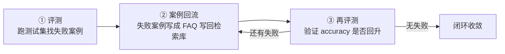

# 第 8 讲：数据飞轮——eval → 案例回流 → RAG 增强

> 本系列用可运行的最小 demo 讲 LangGraph 实战。这是第 8 讲：评测（第 7 讲）找出答不对的问题之后不是终点，把失败案例回流进检索库（第 6 讲的 RAG），再评一遍——把「评测」和「RAG」接成一个能自我改进的闭环。

**TL;DR**：只评不治 = 白评。数据飞轮三步：① **评测**找出失败案例；② **案例回流**把失败案例（问 + 标准答案）写成 FAQ 块写回检索库；③ **再评测**验证改进。demo 里 accuracy 0.60 → 1.00。

---

## 正文

### §1 什么是数据飞轮

第 7 讲评测的产出是一份"失败案例"清单——哪些样本被判错、漏判、答偏了。但评测本身**只诊断、不治病**：跑完看一眼 accuracy 就收工，这批失败案例就白费了。数据飞轮要做的，是把"评测"和"RAG"接成一个闭环——**评测找到失败案例 → 把失败案例回流进检索库 → 再评一次验证改进**，让系统不是"评一次好一次"，而是**越用越准、越评越健壮**。

先说评测的两种形态，分工不同（LangSmith《Evaluation concepts》，见参考文献 #5）：

- **离线评测（offline）**：部署前在开发环境跑，拿应用输出和参考答案（reference）比对，解决"正确性"这类确定性问题，也做**回归测试**——改一处 prompt / 工具后，重跑旧测试集确认没退化。
- **在线评测（online）**：上线后在真实生产流量上实时跑，挂安全性检查、格式校验、质量启发式等，盯着"真实场景下的表现"。

但评测只是飞轮的一个节点，不是终点。完整闭环是文档里这条（见参考文献 #5）：

> `Trace → Evaluate → Monitor → Collect Feedback → Improve → Re-test`

精髓在后三步 **Collect Feedback → Improve → Re-test**：把失败案例**收集**起来 → **改进**（修 prompt / 补数据 / 加检索内容）→ **再测**确认。它的价值浓缩成文档里那句 *"one-off failures become tests you run every time"*——**一次性失败被沉淀成每次迭代都跑的回归测试**，同样的问题不会冒第二次。这才是飞轮让系统"越来越健壮"的机理，而不是"修一个、冒三个"。

要诚实交代的是：**demo 是"离线版飞轮"，且反馈来源不完整**。看 `feedback_node` 这两行：

```python
new_docs = state["docs"] + [faq_chunk(q, a) for q, a in state["failures"]]
return {"docs": new_docs, "round": state["round"] + 1}
```

它跑的是固定测试集 `TEST_SET`（= offline），但"反馈"（`state["failures"]`）来自**测试集里的标准答案**，不是真实用户反馈。换句话说，demo 是**手动把 feedback loop 搬进 offline**——用离线评测的失败案例驱动回流，把闭环的**机制**跑通。生产里的完整飞轮，反馈要来自**线上真实用户 / 人工标注**，否则就成了"拿测试集喂自己"（这个坑 §3 展开）。



### §2 评测：找出失败案例

RAG 评测三维度 correctness / groundedness / retrieval relevance 是一根链条，各评一环（LangSmith《Evaluate a RAG application》，见参考文献 #2）：

- **retrieval relevance**：检索这环——检索回来的文档和用户问题**相不相关**。
- **groundedness**：桥梁——生成的答案**有没有被检索回来的文档支撑**（防幻觉）。它同时被两头影响：检索（回来什么）和生成（有没有忠于文档）。
- **correctness**：生成这环——生成的答案和参考答案**一不一致**。

传导是单向的：**检索坏了 → 有据撑不住 → 正确性大概率崩**。但反过来不成立——"答案对"不能反推"检索对"，这正是只看 correctness 的盲区。两类"答案碰巧对、过程全错"的情形：

1. **retrieval relevance 坏了但答对**：检索回来的文档和问题不相关，模型却靠自身训练知识直接答对。correctness ✓，但你根本不知道检索环节已经坏了——换一道它没背过的题就翻车。
2. **groundedness 坏了但答对**：模型答对了，可答案没被检索文档支撑（是自己脑补 / 幻觉碰巧撞对）。correctness ✓，但这是幻觉的前兆。

再看 demo 怎么评。`judge` 只算了 correctness 一维——拿 LLM-judge 比"候选答案"和"标准答案"：

```python
def judge(query: str, ground_truth: str, candidate: str) -> bool:
    """LLM-judge：候选答案是否回答了问题、与标准答案语义一致。"""
    model = build_model().with_structured_output(Verdict, method="function_calling")
    prompt = (
        f"问题：{query}\n标准答案：{ground_truth}\n候选答案：{candidate}\n"
        "候选答案是否回答了问题、与标准答案语义一致？回答 yes 或 no。"
    )
    return model.invoke(prompt).correct == "yes"
```

关键在配套的 `rag_qa`——它用了"**有据生成**"：

```python
def rag_qa(query: str, docs: list[str]) -> str:
    """检索 → 有据生成。没有相关信息就明说，不编造（这是「答错」能稳定暴露的前提）。"""
    top = hybrid_retrieve(query, docs, k=3)
    context = "\n\n".join(f"[{i + 1}] {d}" for i, d in enumerate(top))
    prompt = (
        "你是产品帮助中心的客服助手。只根据下面检索到的文档回答用户问题；"
        "如果这些文档里没有回答问题所需的信息，就回答「我没有查到相关信息」，不要编造。\n\n"
        f"文档：\n{context}\n\n用户问题：{query}"
    )
    return build_model().invoke(prompt).content
```

"有据生成"这一句 prompt，等于**用设计强制了 groundedness**：模型要么照文档答（grounded），要么明确说"我没查到"（也 grounded，因为它没编）。于是 correctness 一旦失败，责任就**只剩 retrieval relevance 一个嫌疑**——"我没查到" = 检索没召回相关文档。失败案例因此稳定、可解释，每个 ✗ 都能定位到"检索缺了这块知识"，飞轮才有干净的输入喂给下一步回流。

诚实边界：demo 只评了 correctness 一维，是"最简评测"（和第 7 讲"只评最终分类标签"同一个诚实边界）；生产要三维都评，尤其 groundedness 抓幻觉、retrieval relevance 诊断检索。

### §3 案例回流：从哪来 + 存哪

失败案例要回流，先问两个问题：**从哪来**（来源）、**存哪**（存放）。这两件事做不对，飞轮要么转成"背题"，要么一重启就清零。

**① 来源：生产靠真实用户反馈。** 用户在线上点"踩"、留言"答非所问"，这些才是飞轮真正的燃料。LangSmith 里用 `create_feedback` 把反馈挂到某次执行（run）上（#3）：

```python
from langsmith import Client

client = Client()
client.create_feedback(
    run_id=run.id,        # 反馈锚定到「这次执行」
    key="user-thumbs",    # 反馈的键（赞/踩）
    score=0,              # 0 = 踩，1 = 赞
    comment="答非所问，检索到的文档和问题无关",
)
```

为什么必须挂在 run 上？run 是一次**可寻址、可回放、带输入输出和上下文的执行单元**。反馈挂 run 上，等于把"主观评价"锚定到"具体执行上下文"——之后能顺藤摸瓜定位"这次执行到底哪一环错了"（检索？生成？），也支持批量聚合、回归测试和评估闭环。单独存一句"这条答案错了"，只能说明结果不好，却不知道错在哪环。

**诚实边界（飞轮最危险的坑）**：demo 的失败案例来自 `TEST_SET` 的标准答案，不是真实用户反馈。拿测试集喂自己 = **背题（过拟合）**——评测涨得再好看，也证明不了真实场景变好了；而且人工造的测试集，覆盖不了真实用户的分布。这条从简丢了"防过拟合"和"真实分布覆盖"两层能力。

**② 存放：生产靠长期持久化。** 失败案例要沉淀成**可复用测试用例**，跨会话、长期保留——归 **Store**（#1），不是 checkpointer。checkpointer 的语义是**单 thread 的会话状态**（这次对话走到哪、消息历史），是"这次会话"的短时记忆，跨会话/跨用户/重启后，就对不上"长期沉淀"这个语义；失败案例是跨会话的知识，所以进 Store。

**demo 从简**：`feedback_node` 把失败案例写回**内存里的 `docs` 列表**，`faq_chunk` 决定"写成什么样"：

```python
def faq_chunk(question: str, answer: str) -> str:
    """失败案例 → 检索库新块。问句本身成了可被 BM25/dense 命中的关键词。"""
    return f"常见问题：{question}\n答：{answer}"
```

`new_docs = state["docs"] + [faq_chunk(q, a) for q, a in state["failures"]]` 这一行，就是"来源=测试集真值 + 存放=内存列表"两处从简的集中体现。`faq_chunk` 的妙处在于把**问句原样写进库**——"怎么修改配送地址"这串字，第 2 轮直接成了 BM25 能命中的关键词、dense 能对齐的语义向量。但内存列表重启就丢，生产要落到 Store / 数据库 / 向量库（持久化、跨会话共享，版本化下一节展开）。

### §4 回流进数据集：版本化 + 防污染

先看 §3 留下的一处隐患——`faq_chunk` 把问句原样写进库，为什么第 2 轮就能命中？两条线：

- **BM25（词重合）**：第 1 轮"怎么修改配送地址"被 jieba 切成 `["修改","配送","地址"]`，可初始 8 条文档没一个含这些词，得分全 0、召不回。回流后 FAQ 块第一行就是这句问句，三个词全在库里 → 命中排第一。
- **dense（语义向量）**：问句和文档几乎同一句话，余弦相似度自然极高，dense 也把它排第一。

所以"问句原样写进库"的妙处是：**用户怎么问，库就怎么存**，比"官方标准答案"更贴近真实问法（答案写"修改收货信息"，用户问"改地址"，字面不重合 BM25 会漏；写原话则一模一样必中）。

但这同时是**过拟合的技术来源**：demo 里问句 = 文档，是"自己查自己"，第 2 轮必满分——不是泛化变好，是**背题**。真实生产里回流内容应来自真实用户反馈（各种变体问法），而不是把评测集的问句原封不动塞回去。这正是回流必须**版本化 + 防污染**的由头。

**版本化**：对一个持续回流的飞轮，数据集在被反复增删改——没有版本，就没法按时间溯源、没法回滚、也没法复现"某次评测到底跑的是哪份数据"（LangSmith《Manage datasets》，见参考文献 #4）。两个机制各管一件事：

- **tag = 给版本起名钉住**：一旦把 `prod` 打在某个版本上，它就永远指向那个 immutable 版本，之后怎么更新都不影响 `prod`——用来标记"这个版本是已验证的干净版本"。
- **as_of = 按时间取快照**：用时间戳回到"当时的数据集状态"，用在"我没提前打 tag，但想复现 2024-01-01 那次评测用的数据"。

**防污染**：要划清一条线——**版本化挡不住污染**。版本化保证的只是"某个版本的快照不会被悄悄改掉、能事后回滚"，是**事后**的能力；而"把测试集标准答案塞回数据集"是一个**写入动作**，版本化既识别不了、也阻止不了它，只能在污染发生之后让你发现并回滚。真正挡污染的是**事前的流程**：

1. **训练集 / 评测集隔离**：回流的案例进训练/检索库，评测集保持独立，不再被回流污染；
2. **回流内容只收真实反馈 + 人工审核**：来自线上用户反馈（§3 的 `create_feedback`）或人工标注，别把评测集的问句原样塞回；
3. **回流前复核**：写回检索库的内容要过一道审核，别让错误答案 / 脏数据进库。

一句话：**版本化 = 事后可回滚，防污染 = 事前挡住**，两件互补、缺一不可。

**诚实边界**：demo 既没版本化（内存 `docs` 直接 append、无快照无回滚），也没防污染（直接把测试集标准答案塞回）；生产要接 LangSmith 数据集版本化（tag 钉住 + as_of 复现）+ 一套事前的防污染流程。

### §5 RAG 增强：回流后检索变好

回流之后到底是谁变好了？用 §2 的三维度说清楚这条因果链：**groundedness 从头到尾没动**（有据生成一直强制着）；**retrieval relevance 被回流修复了**（回流补上了"修改配送地址 / 价格保护"两块知识缺口，第 2 轮检索能召回相关文档了）；最终**体现在 correctness 上**——demo 第 1 轮 accuracy 0.60、两条缺口答"我没查到"，第 2 轮 accuracy 1.00、全对。链式地看：`retrieval relevance 修复 → 有据生成能拿到相关文档 → 答案 grounded → correctness ✓`。

不过 demo 的"增强"有一处很贵的从简：`dense_search` 每次调用都 `embed_documents(docs)`，也就是**全量重新 embedding 所有文档**。8 条涨到 10 条无所谓，生产里几百万条文档、每回流一条就全量重算一遍，算力/token 和耗时都不可接受。生产要做两件"增量"的事：

- **增量 embedding**：只给**新增**的文档算向量，存量文档的向量不动；
- **向量库 upsert**：把新文档的向量**增量 insert/update 进已有索引**，而不是把整个索引重建一遍（重建也很贵）。

**诚实边界**：回流把 FAQ 块写进库之前，必须过一道**内容审核**——标准答案要来自真实反馈并经过人工复核，确认它"对、干净、无敏感信息"再入库。这不是洁癖：**一个错误答案回流进库，以后所有相关问题都会被它带偏，污染是连锁放大的**（§4 的防污染流程，就是这道把关）。

### §6 总结 + 面试题

一句话收尾：数据飞轮 = **eval → 案例回流 → RAG 增强 → 再评** 的闭环，把第 7 讲（评测找出失败案例）和第 6 讲（RAG 检索）接起来——评测不只是"体检"，失败案例回流成检索库里的新内容，系统才越评越健壮。

三道高频面试题：

**「什么是数据飞轮？和"只做一次评测"有什么区别？」** 数据飞轮是 eval → 案例回流 → RAG 增强 → 再评 的闭环：评测找出失败案例，把失败案例（问 + 标准答案）回流进检索库，再评一次验证。只做一次评测 = 只诊断不治病；飞轮的精髓是 LangSmith 文档那句 *"one-off failures become tests you run every time"*——把一次性失败沉淀成每次迭代都跑的回归测试，同样的问题不再冒第二次。

**「失败案例回流有哪些坑？」** 三个坑：① **来源坑**——拿测试集标准答案喂自己 = 背题（过拟合），评测涨得再好看也证明不了真实场景变好，回流内容应来自真实用户反馈 + 人工审核；② **存放坑**——demo 写回内存 `docs` 列表、重启就丢，生产要落到持久化（LangGraph Store / 数据库 / 向量库）；③ **污染坑**——一个错误答案回流会连锁污染更多答案，要内容审核 + 数据集版本化（事后可回滚）。

**「回流后怎么验证模型是真变好，而不是背题？」** 用 held-out 测试集（回流案例和评测集隔离，别把评测集的问句原样塞回）；配合数据集版本化（tag 钉住干净版本 + as_of 复现某次评测用的数据）；再到评测集之外的新问题上测泛化——背题的话，评测集外的新问题照样翻车。

---

## 参考文献

1. **LangGraph 官方文档《Persistence》** — <https://docs.langchain.com/oss/python/langgraph/persistence>
2. **LangSmith 官方文档《Evaluate a RAG application》** — <https://docs.langchain.com/langsmith/evaluate-rag-tutorial>
3. **LangSmith 官方文档《Log user feedback using the SDK》** — <https://docs.langchain.com/langsmith/attach-user-feedback>
4. **LangSmith 官方文档《Manage datasets》** — <https://docs.langchain.com/langsmith/manage-datasets>
5. **LangSmith 官方文档《Evaluation concepts》** — <https://docs.langchain.com/langsmith/evaluation-concepts>

---

完整代码：[`data_flywheel.py`](https://github.com/wanghesong2019/langgraph-in-action/blob/main/08-data-flywheel/data_flywheel.py)
